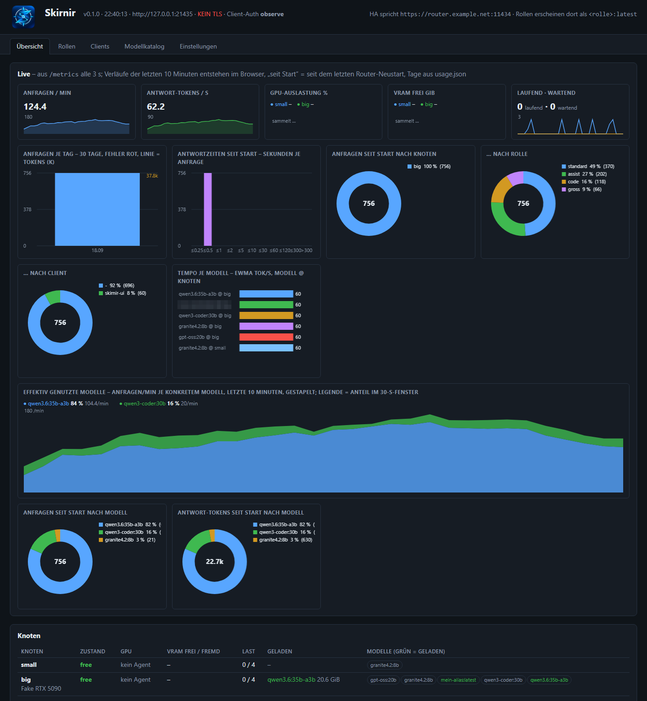

# Betrieb

**Deutsch** · [English](operations.md) · [README](../README.de.md)

## Web-UI



*Übersicht in der lokalen Entwicklungsumgebung (`test/dev_env.py`) mit zwei Fake-Knoten und synthetischem Verkehr. Die UI gibt es auf Englisch und Deutsch (Umschalter in der Kopfzeile).*

`https://<name>:11435/`, Anmeldung mit einem Benutzer aus `control_auth.users`. Eine Seite ([router/ui.html](../router/ui.html) mit ihrem Skript [router/ui.js](../router/ui.js), kein Inline-Skript),
ohne externe Bibliotheken, sechs Tabs:

- **Übersicht:** die aktiven **Probleme** (Schwere, Code und Text in der Sprache der UI, [unten](#probleme));
  Knoten mit Zustand, Breaker, GPU, VRAM, Last und geladenen Modellen; Cloud-Anbieter mit Budgetbalken;
  Betriebskacheln; letzte Entscheidungen; **Live-Grafiken** (Canvas aus `/metrics`):
  Anfragen/min, Tokens/s, GPU und VRAM je Knoten, Tage-Verlauf, Latenz-Histogramm, Anteile nach Knoten/Rolle/Client, effektiv
  genutzte Modelle.
- **Agenten:** registrierte Agenten mit Fakten, Freigabe, Policy je Knoten (WOL, Gewicht, Busy-Schwellen, GPU-Schutz, MQTT,
  Auto-Update), hinterlegte Agent-Version und Update-Stand; Punkt am Tab, solange ein Agent auf Freigabe wartet.
- **Rollen:** Stufen-Editor mit Priorität, Canary, Shadow; **Ausprobieren** (Rolle oder Modell, num_ctx, execution, Datenklasse,
  Priorität, think) mit Knoten, Stufe, Grund, übersprungenen Stufen, Dauer aufgeteilt in Warteschlange / Modell / Router; **Lasttest**
  (n Anfragen mit Parallelität c, dazu Sonden mit `interactive`).
- **Clients:** Karten je Client, Secret erzeugen und rotieren, Quell-IPs, Rollen, Limits.
- **Modellkatalog:** Gewichte, Kontext-Kosten, VRAM-Bedarf, Tempo, Fähigkeiten, Messen und Benchmark; Cloud-Modelle mit Preisen.
- **Einstellungen:** alles, was der Router zur Laufzeit liest (Allowlist in [settings.py](../router/skirnir_router/settings.py)),
  mit config.yaml-Wert, Markierung geänderter Werte und Rücksetzen.

Lokal ansehen ohne echte Knoten: `python test/dev_env.py` startet Fake-Knoten, Fake-Cloud, Fake-Agent und den Router ohne TLS
und Login auf `http://127.0.0.1:21435/`.

Einen einzelnen Knoten für eine Messung ruhigstellen (bis zu einer Zeit kein Entladen und kein Vorwärmen):
`POST /admin/nodes/{fp}/quiet`, vorzeitig beendet mit `DELETE` ([ADR-0061](adr/0061-quiet-a-single-node-for-a-measurement.md);
Endpunkte in [reference.de.md](reference.de.md#schnittstellen)).

## Observability

`GET /metrics` (Steuer-Port, Basic Auth) liefert Prometheus-Text ohne `prometheus_client`, Präfix `skirnir_`:
`requests_total{role,node,model,client,via,outcome}`, `tokens_total{kind,…}`, Histogramme `request_duration_seconds`,
`ttft_seconds`, `queue_wait_seconds`, `events_total{event,node}`, je Knoten `node_up`, `node_state`, `node_inflight`,
`node_gpu_util_percent`, `node_vram_*_gib`, `node_breaker`, je Modell `model_loaded_gib`, `perf_gen_tps`, `perf_error_rate`,
dazu `decision_*`, `cloud_*`, `usage_today_*`, `info` sowie die aktiven Probleme als `problem{code,severity,node,subject}`
und `problems_active` ([unten](#probleme)).

```yaml
scrape_configs:
  - job_name: skirnir
    scheme: https
    metrics_path: /metrics
    basic_auth: { username: metrics, password_file: /etc/prometheus/skirnir.pass }
    static_configs: [{ targets: ["router.example.net:11435"] }]
```

`usage.json` führt 90 Tage lang je Tag und Client Anfragen, Tokens, Fehler und Cloud-Kosten (`GET /admin/usage`). Die Zähler
und Histogramme hinter `/metrics` liegen persistent in `metrics.json` neben der Konfiguration (geschrieben eine Minute nach einer
Änderung und beim Stopp), ein Deploy setzt sie also nicht mehr auf null; die UI nennt sie „gesamt“ seit Beginn der Aufzeichnung.
Für Verläufe über Tage und Wochen gehört ein Prometheus vor `/metrics` (Scrape-Konfiguration oben); der Router ist keine
Zeitreihendatenbank. Genau das liefert [monitoring/](../monitoring/): Prometheus mit 90 Tagen Verlauf und ein Grafana-Dashboard
als zwei Container auf dem Router-Host.

Das Entscheidungsprotokoll (`/admin/state`, 2000 Einträge, persistiert in `events.jsonl` neben der Konfiguration und damit über
Neustarts hinweg; `?decisions=N` wählt die gelieferte Menge, Standard 50) hält die letzten Routen und Ereignisse (busy/free, WOL,
Breaker, Warteschlange, Shadow, Decision). `/admin/state` zeigt außerdem `build` (Deploy-Manifest) und `supply_chain`
(Ollama-Version und Modell-Digests je Knoten). Abgewiesene und begrenzte Anfragen stehen im Audit-Log (`client_auth.audit_log`).

### Probleme

Zustände, um die sich der Betreiber kümmern sollte, während der Router weiter bedient (Router 0.35.0,
[ADR-0101](adr/0101-problems-are-structured-records-exported-as-metrics.md)). Sie entstehen ohne MQTT und erreichen jeden
Kanal aus derselben Liste: `GET /admin/problems[?lang=de|en]` (Steuer-Port, Basic Auth; Einträge mit `code`, `severity`,
`node`, `subject`, `params`, `message`), die Übersicht der Web-UI, `/metrics` und das Home-Assistant-Attribut `problems`.

| Code | Schwere | Wann |
|---|---|---|
| `no_node_online` | critical | Kein Knoten ist online. |
| `role_not_servable` | critical | Kein Knoten online könnte die Rolle (`subject`) bedienen, auch frei nicht; eine Rolle, die nur auf einen belegten Knoten wartet, ist kein Problem. |
| `agent_heartbeat_missing` | warning | Der Agent des Knotens hat schon gemeldet und schweigt länger als `router.agent_missing_problem_s`. |
| `ram_spill` | warning | Ein geladenes Modell (`subject`) liegt mit mindestens `router.ram_spill_problem_gib` im Arbeitsspeicher. |
| `gpu_guard` | warning | Der Agent meldet ein Problem des GPU-Schutzes (nicht verfügbar, abgewählt, Hardware-Warnung), und der Router beachtet den Schutz. Nie für einen Knoten ohne GPU (`gpu_present: false`, ADR-0102). |
| `agent_update_failed`, `agent_update_stalled` | warning | Ein Agent-Update ist fehlgeschlagen oder meldet sich zu lange nicht. |
| `ollama_update_failed`, `ollama_update_stalled` | warning | Dasselbe für ein Ollama-Update. |
| `ollama_version_check_failing` | warning | Die Ollama-Versionsprüfung scheitert seit drei Tagen (oder hat nie geklappt). |
| `cloud_budget_warning` | warning | Ein Anbieter (`subject`) liegt über `warn_at_percent` seines Monatsbudgets. |
| `cloud_budget_exhausted` | critical | Das Monatsbudget eines Anbieters ist aufgebraucht; er fällt als Stufe weg. |

`critical` heißt, Anfragen scheitern oder eine konfigurierte Stufe fällt jetzt weg; `warning` heißt, der Router bedient
weiter, aber langsamer, ohne eine Schutzfunktion oder ohne frische Fakten. In `/metrics` hat `skirnir_problem` eine Reihe je
aktivem Problem (Wert 1, oder die Zahl der Probleme mit denselben Labels) und keine, solange nichts ist; leeres `node` oder
`subject` heißt keiner. Labels tragen nie freien Text; die Werte hinter der Meldung (Minuten, GiB, der Fehler eines Agenten)
stehen in `/admin/problems`. Eine Alarmregel ohne Home Assistant:

```yaml
groups:
  - name: skirnir
    rules:
      - alert: SkirnirProblem
        expr: skirnir_problem > 0
        for: 5m
        annotations: { summary: "{{ $labels.code }} {{ $labels.node }} {{ $labels.subject }}" }
```

## Home-Assistant-Entitäten

Home Assistant ist optional. Ohne `mqtt:`-Abschnitt, oder wenn `paho-mqtt` fehlt, veröffentlicht der Router nichts. Routing,
UI, `/admin/*`, `/metrics` und alle Fakten der Agenten funktionieren genauso: GPU, Spiel, Speicher, Schlaf. Auch das eigene
MQTT-Gerät des Agenten ist optional (`mqtt:` in der Agent-Konfiguration). Der Router veröffentlicht über MQTT mit TLS (Port
8883), das Passwort kommt aus `secrets.env`. Ein mit `install.sh --without-mqtt` installierter Router hat keine MQTT-Bibliothek
und veröffentlicht ebenfalls nichts; vor einem `mqtt:`-Abschnitt ohne die Option erneut installieren (das Skript lehnt die
Option ab, solange einer gesetzt ist).

Der Router meldet sich per MQTT-Discovery als Gerät **Skirnir** an: Sensoren für Knoten online/belegt, verfügbare Modelle,
bereite Rollen (Attribut: welcher Knoten und welches Modell jetzt gewählt würde), Anfragen und Tokens heute, Cloud-Kosten
im Monat, letzte Zuweisung, je Knoten Zustand / GPU-Auslastung / freies VRAM, ein `binary_sensor` **Problem** mit Attribut
`problems` (die Texte der [Probleme](#probleme) in `router.problem_language`: standardmäßig `de`, die Sätze, auf die
Automationen seit Router 0.1 prüfen, oder `en`) und ein Sensor **Knoten wartet auf
Freigabe** für neue Agenten. Last-Will `ollama-router/status=offline` (MQTT-Thema und Entitäts-IDs behalten absichtlich den
alten Namen); fehlende Messwerte sind `unavailable`, nicht `unknown`. Knoten-Entitäten werden nachgeführt: Gesperrte oder
gelöschte Knoten verschwinden aus HA, auch wenn sie während eines Router-Neustarts verschwanden. Home Assistant als Client
anbinden: [clients.de.md](clients.de.md#home-assistant).

**Langsamkeits-Signale** (Router 0.9.2). Wenn ein Modell langsam läuft, schlägt nichts fehl; darum meldet der Router es je
Knoten als Fakt: `binary_sensor.skirnir_node_<knoten>_ram_spill` **Modell teilweise im RAM** ist an, solange Ollama einen Teil
eines geladenen Modells in den Arbeitsspeicher legen musste (`/api/ps`: `size` größer als `size_vram`; diese Schichten rechnen
auf der CPU, jede Anfrage ist vielfach langsamer), mit Modellen und GiB als Attribut; ab `router.ram_spill_problem_gib`
(0,5 GiB, 0 = aus) ist es auch ein **Problem**. `sensor.skirnir_node_<knoten>_gen_tps` und `_prompt_tps` tragen die Erzeugungs-
und Prompt-Rate (tok/s) der letzten warmen Anfrage auf dem Knoten, mit dem Modell als Attribut; eine Antwort unter 20 Token, ein
Prompt unter 200 neuen Token und Benchmarks zählen nicht. Neu sind die Token, die Ollama nicht aus seinem Prompt-Cache bedient
hat (`prompt_eval_cached_count`, Router 0.34.1,
[ADR-0100](adr/0100-the-prompt-rate-counts-only-the-tokens-ollama-processed.md)); über sie wird die Prompt-Rate berechnet, und
ein Knoten, dessen Ollama den Cache-Anteil nicht meldet, sendet keine Prompt-Rate. Die Rohwerte sind für eine Grundlinie in Home
Assistant gedacht (etwa ein Statistik-Helfer mit dem Median einer Woche).

## Agent-Updates und Rollout

Agenten aktualisieren sich über den Router. Die Binaries kommen mit einem Manifest, signiert mit einem Betreiber-Schlüssel (nie
vom Router); die Agenten holen sie über ihre ausgehende Verbindung, prüfen Signatur und Hash, tauschen sich selbst und starten
neu. Ein Release veröffentlichen:

- mit dem eigenständigen Werkzeug: `python deploy/agent_keys.py --keys <ordner> sign-release <dist> --version <v>` schreibt das
  Manifest und die nach dem Release benannten Binaries (`skirnir-agent-<version>-linux-amd64`,
  `skirnir-agent-<version>-windows-amd64.exe`), die nach `/etc/skirnir-router/agent/` auf den Router kopiert werden
  ([ADR-0068](adr/0068-standalone-agent-key-and-release-tool.md));
- in der Deploy-Umgebung des Betreuers: `deploy.py --agent` legt sie direkt auf den Router.

Danach Knopf je Knoten in der Web-UI oder Rollout-Schleife mit Policy je Knoten und einem Kanarienvogel-Knoten, der neue
Versionen zuerst bekommt (`modes.agent_update`: `canary`, `canary_clean_h`). Fehler und Hänger werden HA-Probleme.

Eine signierte Version, die älter ist als die laufende, lehnt der Agent ab (Update-Art `downgrade`); ein bewusster Rückschritt
braucht `update.allow_downgrade: true` in der Konfiguration des Knotens
([ADR-0054](adr/0054-agent-refuses-signed-downgrades.md)). Windows mit Smart App Control blockt unsignierte Binaries, darum wird
die Release-Binary nach dem Build Authenticode-signiert (`agent/sign.ps1`; `deploy.py --agent` verweigert eine unsignierte
Binary, sobald ein Signier-Thumbprint konfiguriert ist).

## Ein Release prüfen

Wird ein Release veröffentlicht, baut der Workflow *Release provenance* die Agent-Binaries aus dem Tag nach (sauberer
Export von `agent/`, die im veröffentlichten Binary vermerkte Go-Version, CGO aus, `-trimpath`) und vergleicht sie Byte
für Byte mit den Release-Dateien. Nur wenn sie gleich sind, bestätigt GitHub ihre Herkunft (Attestierung), und das Release
bekommt CycloneDX-SBOMs: eine je Agent-Binary (Go-Version, Module mit `go.sum`-Hash, Build-Einstellungen) und eine für die
Python-Abhängigkeiten des Routers (`skirnir-router-<version>.cdx.json`). Ein Unterschied lässt den Workflow mit beiden
Hashes scheitern (ADR-0075). Ein heruntergeladenes Binary prüfen:

```bash
gh attestation verify skirnir-agent-<version>-windows-amd64.exe --repo psewar/skirnir
```

Vertrauensanker des Agent-Selbstupdates bleibt die Ed25519-Signatur des Betreibers am Update-Manifest; die Attestierung
zeigt, dass die veröffentlichten Bytes aus dem getaggten Quelltext stammen. Für ein früheres Release den Workflow von
Hand mit dessen Tag starten.

## Ollama-Updates

Router 0.3.0, Agent 0.12.0. Läuft Ollama als Kind des Agent-Dienstes, greift der Updater der Tray-App nicht mehr (er läuft
unter dem Desktop-Benutzer, der Installer ist ein Pro-Benutzer-Installer). Der Router prüft alle paar Stunden das neueste
Ollama-Release und zeigt es je Knoten im Tab *Agenten*; die Policy *Ollama-Auto-Update* je Knoten lässt die Rollout-Schleife
Knoten im Nachtfenster nachziehen (`modes.ollama_update`, Standard 02:00 bis 05:00 Ortszeit des Routers), Kanarienvogel zuerst,
nur wenn der Knoten frei ist. Der Agent lädt das Release-Archiv (`ollama.exe` plus `lib/ollama`, kein Installer) von seiner
eigenen festen Quelle und prüft es gegen die `sha256sum.txt` des Releases, während Ollama weiter Anfragen bedient. Erst dann
meldet er *ready*; der Router nimmt den Knoten aus dem Routing, wartet, bis keine Anfrage mehr läuft, und gibt den Tausch frei
(Agent 0.15.0). Der Agent hält Ollama an, tauscht die Dateien, startet neu und setzt zurück, wenn die neue Version nicht
antwortet. Während eines Updates wärmt der Router den Knoten nicht vor, danach einmal. Der Router wählt also nur die Version,
nie den Code, und seit Agent 0.31.0 keine ältere: Ein Auftrag unter dem installierten Ollama (oder eine Vorabversion) wird
abgelehnt, ausser die Konfiguration des Knotens setzt `ollama_update.allow_downgrade: true` für ein bewusstes Zurückgehen
(ADR-0073). Vorerst nur Windows-Knoten; die Linux-Archive sind tar.zst.

**Release-Quelle** (Router 0.41.0, ADR-0117): `modes.ollama_update.release_source` wählt, woher der Router die neueste
Version erfährt. `github` (Standard) liest wie bisher die GitHub-API unter `release_url`. `document` liest unter
`release_url` ein neutrales Release-Dokument, etwa von einem Spiegel oder einem internen Verzeichnis ohne GitHub-Zugang:

```json
{"version": "0.35.1",
 "files": {"windows/amd64": {"url": "https://mirror.example.net/ollama/v0.35.1/ollama-windows-amd64.zip",
                             "sha256": "<64 Hex-Ziffern>", "size": 1900000000}}}
```

Die Regeln sind streng (ADR-0124): endgültige HTTPS-URL (einfaches HTTP nur an `127.0.0.1`/`::1`), keine Umleitung,
höchstens 64 KiB, 20 s, `version` in der Versionsschreibweise des Agenten, `sha256` mit 64 Hex-Ziffern, `size` in Byte,
und jede `url` endet auf den Archivnamen, den der Agent für diese Plattform erwartet. Plattformen ohne Agent-Archiv werden
übersprungen; ein fehlerhafter Eintrag für eine bekannte Plattform verwirft das ganze Dokument, und der Router behält die
zuletzt bekannte Version (Problem `ollama_version_check_failing` nach drei Tagen ohne erfolgreiche Prüfung). Das Dokument nennt nur die Version
und die erwarteten Hashes. Der Agent lädt weiterhin von seiner eigenen Quelle `ollama_update.source` im Layout
`<source>v<version>/<archiv>` und `<source>v<version>/sha256sum.txt` und lehnt einen Auftrag ab, dessen Hash nicht zur
`sha256sum.txt` dieser Quelle passt. Für einen Spiegel zeigen also beide Seiten auf ihn: der Router auf das Dokument, jeder
Agent mit `ollama_update.source` auf das Verzeichnis. Am Agenten ändert sich nichts.

**Wecken im Protokoll:** Jeder Weckversuch erscheint im Entscheidungsprotokoll als Ereignis `wol` mit dem Feld `waker`
(`wol` oder dem Namen aus `router.wakers`); das Journal schreibt `WOL <knoten> (<mac>)` oder `wake via <wecker> <knoten>
(<host> HTTP <status>)`. Konnte ein Wecker nichts senden, steht dort `wake <knoten> via <wecker>: ... (<art>)` mit einer festen
Art: `wake_no_mac`, `wake_send_failed`, `wake_unknown_waker`, `wake_secret_missing`, `wake_unreachable`, `wake_redirect`,
`wake_refused`; dann wartet der Router nicht, sondern antwortet sofort mit 503. Konfiguration:
[configuration.de.md](configuration.de.md#knoten-wecken).

## Secrets-Renderer

`render-env.sh` rendert `secrets.env` vor jedem Start des Routers (`skirnir-router-secrets.service`) und mit dem optionalen
Timer täglich (`skirnir-router-secrets-refresh.service`, startet den Router neu, wenn sich die Datei geändert hat). Seine
Ausgabe steht im Journal: `journalctl -u skirnir-router-secrets -u skirnir-router-secrets-refresh`. Jeder Lauf endet mit einer
Zustandszeile ([install-router.de.md](install-router.de.md#secrets), ADR-0104):

| Zustand | Bedeutung | Nächster Schritt |
|---|---|---|
| `STATE: written` | Die Datei wurde ersetzt; die Zeile davor nennt, wie viele der Namen vorhanden waren. | Keiner. Als `missing in the source` gemeldete Namen stehen einfach nicht in der Datei. |
| `STATE: unchanged` | Gleicher Inhalt wie bisher. | Keiner. |
| `STATE: kept` | Die bestehende Datei bleibt: Die Quelle ist nicht bereit (`secret store not reachable`, `refused the login (HTTP ...)`, `SECRET_FILE ... missing`), ein Name liess sich nicht abrufen (`fetch failed (...)`; ein vorübergehender Fehler lässt nichts wegfallen), oder die Quelle enthält keinen der Namen. | Beheben, was die Zeile davor nennt; der nächste Lauf oder `systemctl start skirnir-router-secrets` rendert erneut. Um die Datei bewusst zu leeren, sie von Hand löschen. |
| `STATE: not-configured` | Keine `render-env.conf`: `secrets.env` wird von Hand gepflegt. | Keiner, oder eine Quelle einrichten. |
| `STATE: refused` | `render-env.conf`, `SECRET_STORE_AUTH_FILE` oder `SECRET_FILE` hat eine Prüfung nicht bestanden (Besitzer, Modus, ein Pfad, den der Router schreiben darf), die Konfiguration ist unvollständig, oder `SECRET_SOURCE` ist unbekannt. | Die Datei beheben, die die Zeile davor nennt. |

Ein Wert mit Zeilenumbruch wird nie geschrieben (er würde eine weitere Variable in der Umgebung der Router-Unit beginnen);
der Name wird gemeldet und übersprungen. Kein Secret-Wert erscheint in der Ausgabe.

## Schlüsselwechsel

Der Signierschlüssel der Agenten lässt sich ohne Lücke wechseln
([ADR-0058](adr/0058-rotate-the-agent-signing-key-with-several-trusted-keys.md)):

1. Den nächsten Schlüssel erzeugen: `python deploy/agent_keys.py --keys <ordner> next` (oder `deploy.py --new-agent-key`); er
   zeigt den öffentlichen Teil.
2. Ihn auf allen Knoten in `update.public_keys` eintragen. Auf Windows-Knoten erledigt
   `agent\Set-UpdateKey.cmd -Step Add -Key <öffentlicher Schlüssel>` das als Administrator, mit Sicherung, `check-config` und
   Rückweg.
3. Das Signieren umstellen: `python deploy/agent_keys.py --keys <ordner> use-next` (oder `deploy.py --use-next-agent-key`); der
   alte Schlüssel wird als ausgemustert aufbewahrt.
4. Jeden Knoten eine mit dem neuen Schlüssel signierte Version installieren lassen. Ein Knoten, der ihm noch nicht vertraut,
   behält seine Binary und meldet eine ungültige Manifest-Signatur.
5. Den alten öffentlichen Schlüssel von den Knoten entfernen: `Set-UpdateKey.cmd -Step Complete -Key <neuer öffentlicher Schlüssel>`
   (der neue Schlüssel wird `update.public_key`).

**Signierschlüssel verloren** ([ADR-0066](adr/0066-explicit-agent-key-creation-and-lost-key-recovery.md)):
`python deploy/agent_keys.py --keys <ordner> replace-lost "<grund>"` (oder `deploy.py --replace-lost-agent-key "<grund>"`)
erzeugt einen neuen samt Protokoll, und jeder Knoten braucht `Set-UpdateKey.cmd -Step Replace -Key <neuer öffentlicher Schlüssel>`
(unter Linux `update.public_key` von Hand setzen), bevor er wieder ein Release annimmt. Keines der Werkzeuge legt stillschweigend
einen Schlüssel an: `create` (oder `deploy.py --create-agent-key`) ist nur für eine neue Installation.

## Was sichern

Skirnir hat keine eigene Backup-Funktion; diese Dateien mit dem Werkzeug sichern, das ohnehin läuft. Die Pfade sind die
Standards von `install.sh` und vom `setup` des Agenten; ein anderes `--config-dir`, `router.state_dir` oder `identity.dir`
verschiebt sie.

**Router**

| Was | Standardpfad | Warum |
|---|---|---|
| Konfigurationsordner | `/etc/skirnir-router/` | `config.yaml` (schreiben nur Root-Werkzeuge, nie der Router), die Zertifikate in `certs/` (oder `tls/` bei älteren Installationen) und der Release-Ordner `agent/` (`manifest.json` und die signierten Agent-Binaries; lassen sich auch erneut aus einem Release kopieren). |
| Quelle der Secrets | der eigene Secret-Store und `/etc/skirnir-router-secrets/render-env.conf` mit dem Zugang dazu (mit `SECRET_SOURCE=file`: statt des Stores die Datei, die `SECRET_FILE` nennt) | `secrets.env` wird daraus erzeugt und lässt sich neu erzeugen: die Quelle sichern, nicht die erzeugte Datei. Wer `secrets.env` von Hand pflegt, hat sie als Quelle. Die Zugangsdatei enthält ein Geheimnis; ihr Backup so geschützt halten wie die Datei selbst. |
| Zustandsordner (`router.state_dir`) | `/var/lib/skirnir-router/` | Alles, was der Router selbst schreibt, siehe nächste Tabelle. Ohne `state_dir` liegen diese Dateien neben der `config.yaml`. |
| Session-Datenbank (optional) | die PostgreSQL-Datenbank oder die SQLite-Datei, die `SKIRNIR_SESSION_DSN` (`session_store.dsn_env`) nennt (ADR-0114) | Sessions (Ereignisse, verwaltete Turns, Verdichtungen, Übergabe-Importe) und die Memory-Outbox. PostgreSQL: mit dessen eigenen Werkzeugen sichern. SQLite: siehe `sessions.db` unten. |
| Gedächtnis-Backend (optional) | ausserhalb von Skirnir (Hindsight) | Dort liegt das Langzeitgedächtnis; sichern, wie dieser Dienst es beschreibt. |
| Logs | `/var/log/skirnir-router/` | `audit.jsonl` (`client_auth.audit_log`), falls der Audit-Verlauf gebraucht wird. |

Dateien im Zustandsordner:

| Datei | Inhalt | Wenn sie fehlt |
|---|---|---|
| `nodes.json` | Knotenregister: öffentlicher Schlüssel, Freigabezustand, Policy und Fakten je Agent | jeder Knoten erscheint als wartend und muss neu freigegeben werden |
| `roles.yaml` | was die Web-UI geändert hat: Rollen, Modelle, Einstellungen, in der UI angelegte Clients (Token-Hashes) | die UI-Änderungen sind weg; es gilt nur die `config.yaml` |
| `deletions.jsonl` | Löschjournal, nur IDs (ADR-0076) | eine zurückgespielte Datenbank bringt gelöschte Sessions und Gedächtnis zurück; siehe unten |
| `sessions.db` (bei `sqlite:///sessions.db`; der Name ist frei) | der SQLite-Session-Store: Session-Inhalte und die Memory-Outbox, nur für den Besitzer lesbar (0600). Bei laufendem Router nur mit `sqlite3 sessions.db ".backup /backup/sessions.db"` kopieren; eine einfache Kopie kann verpassen, was noch in `sessions.db-wal` steht. Bei gestopptem Router genügt eine Kopie der Datei | gespeicherte Sessions und offene Memory-Aufträge sind weg; der Router legt einen leeren Store an |
| `usage.json` | Nutzung je Client und Monat, auch die Cloud-Ausgaben je Anbieter | das monatliche Cloud-Budget beginnt wieder bei null |
| `metrics.json`, `perf.json` | kumulierte Zähler; gemessene Geschwindigkeit je Modell und Knoten für den Katalog | Zähler und Geschwindigkeitswerte beginnen von vorn |
| `events.jsonl` | das Ereignis- und Entscheidungsprotokoll, das die Web-UI zeigt | nur Verlauf |
| `requests.jsonl` | Entscheidungsbeobachtung (`decision_engine.observe_all`) | nur Beobachtungsdaten |
| `ollama-latest.json` | zuletzt bekanntes Ollama-Release | nichts, wird neu geholt |

Die optionale Entscheidungsaufzeichnung schreibt an ihren eigenen Pfad (`decision_engine.capture.path`, Standard
`/var/lib/skirnir-router/decisions.jsonl`), standardmässig also in den Zustandsordner.

**Knoten und Betreiber**

| Was | Standardpfad | Warum |
|---|---|---|
| Agent-Konfiguration | Windows `C:\ProgramData\skirnir-agent\config.yaml`, Linux `/etc/skirnir-agent/config.yaml` | Router-URL, `update.public_key(s)`, Kinder und lokale Einstellungen |
| Agent-Identität | das `identity.dir`: Windows `C:\ProgramData\skirnir-agent\identity\`, Linux (nach `setup`) `/var/lib/skirnir-agent/identity/` | `agent-identity.key` ist die Identität des Knotens gegenüber dem Router; `provisioned.json` ist das letzte Paket vom Router und kommt bei der nächsten Verbindung wieder. Unter Windows sind beide per DPAPI an die Maschine gebunden und lassen sich nur auf dieselbe Windows-Installation zurückspielen; nach einer Neuinstallation erzeugt der Agent einen neuen Schlüssel und der Knoten wird neu freigegeben. |
| Update-Signierschlüssel | der Schlüsselordner des Betreibers (`deploy/agent_keys.py --keys <ordner>`), nicht auf dem Router | `agent-update.key`, ein vorbereiteter `agent-update.next.key` und die ausgemusterten Schlüssel. Ohne ihn nimmt kein Knoten ein neues Release an, bis jeder Knoten einem Ersatz vertraut (siehe [Schlüsselwechsel](#schlüsselwechsel), Signierschlüssel verloren). Das Backup offline und verschlüsselt aufbewahren. |

## Ein Backup zurückspielen

Löschungen stehen ausserhalb der Datenbank, nur als IDs, in `deletions.jsonl` im Zustandsordner des Routers
(`router.state_dir`, sonst neben der `config.yaml`; ADR-0076):

1. **Session-Datenbank zurückgespielt** (PostgreSQL, oder die SQLite-Datei bei gestopptem Router zurückkopiert und ihre
   `-wal`- und `-shm`-Dateien entfernt): den Router wie gewohnt starten. Bevor die Outbox etwas
   sendet, wendet er das Journal erneut an; das Log nennt, wie viele Sessions und Operationen wieder da waren und erneut
   gelöscht sind. `deletions.jsonl` nie älter als die Datenbank zurückspielen - aus dem Datenbank-Restore heraushalten.
2. **Hindsight zurückgespielt**: Dokumente gelöschter Operationen sind wieder da. Seitenweise erneut löschen:

   ```bash
   curl -u admin -X POST https://<router>:11435/admin/memory/reconcile-deletions -H 'Content-Type: application/json' \
     -d '{"after": "00000000-0000-0000-0000-000000000000", "limit": 500}'
   ```

   Mit `"after": <next>` wiederholen, bis `next` null ist. `unavailable` zählt Dokumente, für die Hindsight nicht
   antwortete; später erneut laufen lassen.
3. `skirnir_memory_deletions_stuck` beobachten: Löschungen, deren Job tot oder widerrufen endete, brauchen einen Blick.

## Namen

Seit Router 0.2.0 / Agent 0.11.0 folgen die technischen Namen dem Produkt: Paket `skirnir_router`, Dienst und Pfade
`skirnir-router` (`/opt/skirnir-router`, `/etc/skirnir-router`), Agent-Binary `skirnir-agent`, Windows-Dienst `SkirnirAgent`
(„Skirnir Agent“). `deploy.py` zieht eine bestehende Router-Installation einmalig um (Verzeichnisse, Units), das `setup` des
Agenten einen bestehenden Knoten (Verzeichnisse, Dienst, Relay-Aufgabe). Ein Agent, der sich unter dem alten Dateinamen
selbst aktualisiert hat, läuft weiter: Alter Konfigurationspfad, Dienst- und Aufgabenname werden als Rückfall gefunden, bis
`setup` gelaufen ist. Auch die MQTT-Seite ist umgezogen: Basisthema `skirnir-router`, Discovery-Node-ID `skirnir_router`,
unique_ids `skirnir_router_*`, Entitäts-IDs `<domain>.skirnir_*` (seit Router 0.9.0 englisch über `default_entity_id`, siehe
[design/english-names.md](../design/english-names.md)); die retained Themen der alten Namen räumt der Router beim ersten
Connect weg. Home Assistant führt Registereinträge je unique_id, darum müssen angepasste Entitäts-IDs der alten Entitäten einmal
übertragen werden (Betriebsskript über die WebSocket-API); die Recorder-Historie wandert nicht mit.

## Messwerte als Anhaltspunkt

VRAM-Bedarf nach der Formel in [configuration.de.md](configuration.de.md#rollen-und-stufen), gemessen auf einer 32-GB-GPU
(31,8 GiB nutzbar, KV-Cache f16, Ollama 0.33/0.34); Tempo aus dem UI-Benchmark (200 Token, temperature 0, Median aus zwei
Läufen, Kontext 8k).

| Modell | Gewichte GiB | Kontext-Kosten MiB/1k | VRAM @8k / @32k / @64k GiB | gen tok/s | prompt tok/s | Fähigkeiten |
|---|---|---|---|---|---|---|
| qwen3.6:35b-a3b | 20,6 | 1 | 21,4 / 21,4 / 21,5 | 254 | 1219 | vision, tools, thinking |
| qwen3-coder:30b | 17,3 | 98 | 18,9 / 21,2 / 24,2 | 285 | 5964 | tools |
| glm-4.7-flash | 17,7 | 50 | 18,9 / 20,1 / 21,7 | 224 | 10689 | tools, thinking |
| granite4.2:30b | 16,8 | 248 | 19,5 / 25,3 / 33,1 ✗ | 76 | 3478 | tools, thinking |
| gemma4:26b | 16,1 | 12 | 17,0 / 17,3 / 17,7 | 233 | 1822 | vision, tools, thinking |
| gpt-oss:20b | 12,0 | 2 | 12,8 / 12,8 / 12,9 | 270 | 6712 | tools, thinking (kein `structured`) |
| gemma4:12b (kleinere zweite GPU) | 7,8 | 2 | 8,6 / 8,6 / 8,7 | 71 | 1277 | vision, tools, thinking |
| granite4.2:8b | 5,0 | 162 | 7,0 / 10,8 / 15,9 | 213 | 7919 | tools, thinking |

Modelle mit hybrider Attention (qwen3.6, gemma4, gpt-oss) kosten pro Kontext-Token praktisch kein VRAM; granite und die
Coder-Modelle zahlen spürbar. Thinking-Modelle erzeugen ohne `think: false` unsichtbare Denk-Token – die Antwortdauer ist dann
kein Maß für das Tempo. Neu messen, wenn Ollama, Treiber oder KV-Cache-Typ wechseln.
