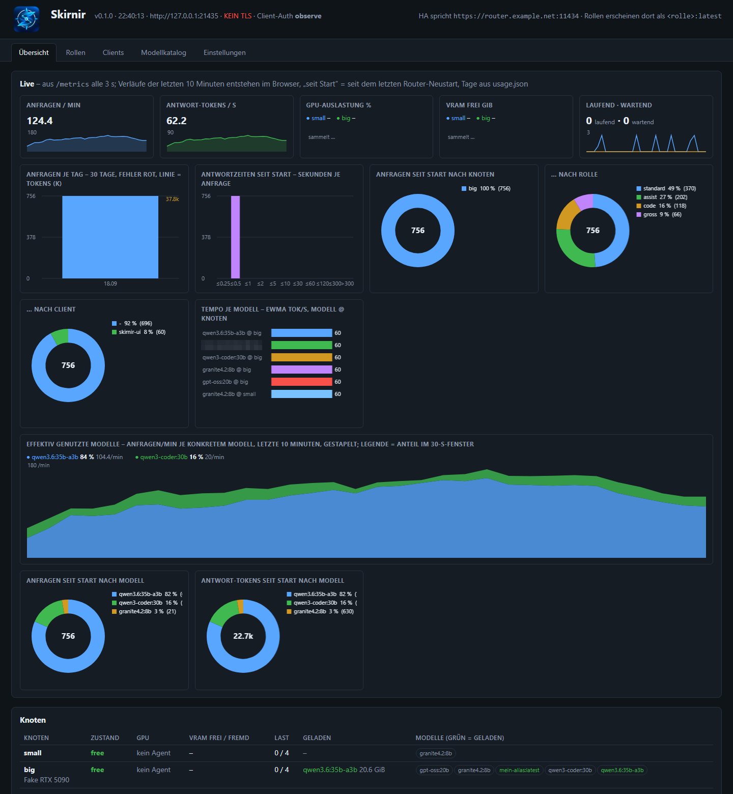

# Betrieb

**Deutsch** · [English](operations.md) · [README](../README.de.md)

## Web-UI



*Übersicht in der lokalen Entwicklungsumgebung (`test/dev_env.py`) mit zwei Fake-Knoten und synthetischem Verkehr. Die UI gibt es auf Englisch und Deutsch (Umschalter in der Kopfzeile).*

`https://<name>:11435/`, Anmeldung mit einem Benutzer aus `control_auth.users`. Eine Seite ([router/ui.html](../router/ui.html)),
ohne externe Bibliotheken, sechs Tabs:

- **Übersicht:** Knoten mit Zustand, Breaker, GPU, VRAM, Last und geladenen Modellen; Cloud-Anbieter mit Budgetbalken;
  Betriebskacheln; letzte Entscheidungen; **Live-Grafiken** (Canvas aus `/metrics`):
  Anfragen/min, Tokens/s, GPU und VRAM je Knoten, Tage-Verlauf, Latenz-Histogramm, Anteile nach Knoten/Rolle/Client, effektiv
  genutzte Modelle.
- **Agenten:** registrierte Agenten mit Fakten, Freigabe, Policy je Knoten (WOL, Gewicht, Busy-Schwellen, GPU-Schutz, MQTT,
  Auto-Update), hinterlegte Agent-Version und Update-Stand; Punkt am Tab, solange ein Agent auf Freigabe wartet.
- **Rollen:** Stufen-Editor mit Priorität, Canary, Shadow; **Ausprobieren** (Rolle oder Modell, num_ctx, execution, Datenklasse,
  Priorität, think) mit Knoten, Stufe, Grund, übersprungenen Stufen, Dauer aufgeteilt in Warteschlange / Modell / Router; **Lasttest**
  (n Anfragen mit Parallelität c, dazu Sonden mit `interactive`).
- **Clients:** Karten je Client, Secret erzeugen und rotieren, Quell-IPs, Rollen, Limits.
- **Modellkatalog:** Gewichte, Kontext-Kosten, VRAM-Bedarf, Tempo, Fähigkeiten, Messen und Benchmark; Cloud-Modelle mit Preisen.
- **Einstellungen:** alles, was der Router zur Laufzeit liest (Allowlist in [settings.py](../router/skirnir_router/settings.py)),
  mit config.yaml-Wert, Markierung geänderter Werte und Rücksetzen.

Lokal ansehen ohne echte Knoten: `python test/dev_env.py` startet Fake-Knoten, Fake-Cloud, Fake-Agent und den Router ohne TLS
und Login auf `http://127.0.0.1:21435/`.

Einen einzelnen Knoten für eine Messung ruhigstellen (bis zu einer Zeit kein Entladen und kein Vorwärmen):
`POST /admin/nodes/{fp}/quiet`, vorzeitig beendet mit `DELETE` ([ADR-0061](adr/0061-quiet-a-single-node-for-a-measurement.md);
Endpunkte in [reference.de.md](reference.de.md#schnittstellen)).

## Observability

`GET /metrics` (Steuer-Port, Basic Auth) liefert Prometheus-Text ohne `prometheus_client`, Präfix `skirnir_`:
`requests_total{role,node,model,client,via,outcome}`, `tokens_total{kind,…}`, Histogramme `request_duration_seconds`,
`ttft_seconds`, `queue_wait_seconds`, `events_total{event,node}`, je Knoten `node_up`, `node_state`, `node_inflight`,
`node_gpu_util_percent`, `node_vram_*_gib`, `node_breaker`, je Modell `model_loaded_gib`, `perf_gen_tps`, `perf_error_rate`,
dazu `decision_*`, `cloud_*`, `usage_today_*`, `info`.

```yaml
scrape_configs:
  - job_name: skirnir
    scheme: https
    metrics_path: /metrics
    basic_auth: { username: metrics, password_file: /etc/prometheus/skirnir.pass }
    static_configs: [{ targets: ["router.example.net:11435"] }]
```

`usage.json` führt 90 Tage lang je Tag und Client Anfragen, Tokens, Fehler und Cloud-Kosten (`GET /admin/usage`). Die Zähler
und Histogramme hinter `/metrics` liegen persistent in `metrics.json` neben der Konfiguration (geschrieben eine Minute nach einer
Änderung und beim Stopp), ein Deploy setzt sie also nicht mehr auf null; die UI nennt sie „gesamt“ seit Beginn der Aufzeichnung.
Für Verläufe über Tage und Wochen gehört ein Prometheus vor `/metrics` (Scrape-Konfiguration oben); der Router ist keine
Zeitreihendatenbank. Genau das liefert [monitoring/](../monitoring/): Prometheus mit 90 Tagen Verlauf und ein Grafana-Dashboard
als zwei Container auf dem Router-Host.

Das Entscheidungsprotokoll (`/admin/state`, 2000 Einträge, persistiert in `events.jsonl` neben der Konfiguration und damit über
Neustarts hinweg; `?decisions=N` wählt die gelieferte Menge, Standard 50) hält die letzten Routen und Ereignisse (busy/free, WOL,
Breaker, Warteschlange, Shadow, Decision). `/admin/state` zeigt außerdem `build` (Deploy-Manifest) und `supply_chain`
(Ollama-Version und Modell-Digests je Knoten). Abgewiesene und begrenzte Anfragen stehen im Audit-Log (`client_auth.audit_log`).

## Home-Assistant-Entitäten

Home Assistant ist optional. Ohne `mqtt:`-Abschnitt, oder wenn `paho-mqtt` fehlt, veröffentlicht der Router nichts. Routing,
UI, `/admin/*`, `/metrics` und alle Fakten der Agenten funktionieren genauso: GPU, Spiel, Speicher, Schlaf. Auch das eigene
MQTT-Gerät des Agenten ist optional (`mqtt:` in der Agent-Konfiguration). Der Router veröffentlicht über MQTT mit TLS (Port
8883), das Passwort kommt aus `secrets.env`.

Der Router meldet sich per MQTT-Discovery als Gerät **Skirnir** an: Sensoren für Knoten online/belegt, verfügbare Modelle,
bereite Rollen (Attribut: welcher Knoten und welches Modell jetzt gewählt würde), Anfragen und Tokens heute, Cloud-Kosten
im Monat, letzte Zuweisung, je Knoten Zustand / GPU-Auslastung / freies VRAM, ein `binary_sensor` **Problem** mit Attribut
`problems` (kein Knoten online, Rolle nicht bedienbar, Agent schweigt, Budget-Warnung) und ein Sensor **Knoten wartet auf
Freigabe** für neue Agenten. Last-Will `ollama-router/status=offline` (MQTT-Thema und Entitäts-IDs behalten absichtlich den
alten Namen); fehlende Messwerte sind `unavailable`, nicht `unknown`. Knoten-Entitäten werden nachgeführt: Gesperrte oder
gelöschte Knoten verschwinden aus HA, auch wenn sie während eines Router-Neustarts verschwanden. Home Assistant als Client
anbinden: [clients.de.md](clients.de.md#home-assistant).

**Langsamkeits-Signale** (Router 0.9.2). Wenn ein Modell langsam läuft, schlägt nichts fehl; darum meldet der Router es je
Knoten als Fakt: `binary_sensor.skirnir_node_<knoten>_ram_spill` **Modell teilweise im RAM** ist an, solange Ollama einen Teil
eines geladenen Modells in den Arbeitsspeicher legen musste (`/api/ps`: `size` größer als `size_vram`; diese Schichten rechnen
auf der CPU, jede Anfrage ist vielfach langsamer), mit Modellen und GiB als Attribut; ab `router.ram_spill_problem_gib`
(0,5 GiB, 0 = aus) ist es auch ein **Problem**. `sensor.skirnir_node_<knoten>_gen_tps` und `_prompt_tps` tragen die Erzeugungs-
und Prompt-Rate (tok/s) der letzten warmen Anfrage auf dem Knoten, mit dem Modell als Attribut; eine Antwort unter 20 Token, ein
Prompt unter 200 neuen Token und Benchmarks zählen nicht. Die Rohwerte sind für eine Grundlinie in Home Assistant gedacht (etwa
ein Statistik-Helfer mit dem Median einer Woche).

## Agent-Updates und Rollout

Agenten aktualisieren sich über den Router. Die Binaries kommen mit einem Manifest, signiert mit einem Betreiber-Schlüssel (nie
vom Router); die Agenten holen sie über ihre ausgehende Verbindung, prüfen Signatur und Hash, tauschen sich selbst und starten
neu. Ein Release veröffentlichen:

- mit dem eigenständigen Werkzeug: `python deploy/agent_keys.py --keys <ordner> sign-release <dist> --version <v>` schreibt das
  Manifest und die nach dem Release benannten Binaries (`skirnir-agent-<version>-linux-amd64`,
  `skirnir-agent-<version>-windows-amd64.exe`), die nach `/etc/skirnir-router/agent/` auf den Router kopiert werden
  ([ADR-0068](adr/0068-standalone-agent-key-and-release-tool.md));
- in der Deploy-Umgebung des Betreuers: `deploy.py --agent` legt sie direkt auf den Router.

Danach Knopf je Knoten in der Web-UI oder Rollout-Schleife mit Policy je Knoten und einem Kanarienvogel-Knoten, der neue
Versionen zuerst bekommt (`modes.agent_update`: `canary`, `canary_clean_h`). Fehler und Hänger werden HA-Probleme.

Eine signierte Version, die älter ist als die laufende, lehnt der Agent ab (Update-Art `downgrade`); ein bewusster Rückschritt
braucht `update.allow_downgrade: true` in der Konfiguration des Knotens
([ADR-0054](adr/0054-agent-refuses-signed-downgrades.md)). Windows mit Smart App Control blockt unsignierte Binaries, darum wird
die Release-Binary nach dem Build Authenticode-signiert (`agent/sign.ps1`; `deploy.py --agent` verweigert eine unsignierte
Binary, sobald ein Signier-Thumbprint konfiguriert ist).

## Ein Release prüfen

Wird ein Release veröffentlicht, baut der Workflow *Release provenance* die Agent-Binaries aus dem Tag nach (sauberer
Export von `agent/`, die im veröffentlichten Binary vermerkte Go-Version, CGO aus, `-trimpath`) und vergleicht sie Byte
für Byte mit den Release-Dateien. Nur wenn sie gleich sind, bestätigt GitHub ihre Herkunft (Attestierung), und das Release
bekommt CycloneDX-SBOMs: eine je Agent-Binary (Go-Version, Module mit `go.sum`-Hash, Build-Einstellungen) und eine für die
Python-Abhängigkeiten des Routers (`skirnir-router-<version>.cdx.json`). Ein Unterschied lässt den Workflow mit beiden
Hashes scheitern (ADR-0075). Ein heruntergeladenes Binary prüfen:

```bash
gh attestation verify skirnir-agent-<version>-windows-amd64.exe --repo psewar/skirnir
```

Vertrauensanker des Agent-Selbstupdates bleibt die Ed25519-Signatur des Betreibers am Update-Manifest; die Attestierung
zeigt, dass die veröffentlichten Bytes aus dem getaggten Quelltext stammen. Für ein früheres Release den Workflow von
Hand mit dessen Tag starten.

## Ollama-Updates

Router 0.3.0, Agent 0.12.0. Läuft Ollama als Kind des Agent-Dienstes, greift der Updater der Tray-App nicht mehr (er läuft
unter dem Desktop-Benutzer, der Installer ist ein Pro-Benutzer-Installer). Der Router prüft alle paar Stunden das neueste
Ollama-Release und zeigt es je Knoten im Tab *Agenten*; die Policy *Ollama-Auto-Update* je Knoten lässt die Rollout-Schleife
Knoten im Nachtfenster nachziehen (`modes.ollama_update`, Standard 02:00 bis 05:00 Ortszeit des Routers), Kanarienvogel zuerst,
nur wenn der Knoten frei ist. Der Agent lädt das Release-Archiv (`ollama.exe` plus `lib/ollama`, kein Installer) von seiner
eigenen festen Quelle und prüft es gegen die `sha256sum.txt` des Releases, während Ollama weiter Anfragen bedient. Erst dann
meldet er *ready*; der Router nimmt den Knoten aus dem Routing, wartet, bis keine Anfrage mehr läuft, und gibt den Tausch frei
(Agent 0.15.0). Der Agent hält Ollama an, tauscht die Dateien, startet neu und setzt zurück, wenn die neue Version nicht
antwortet. Während eines Updates wärmt der Router den Knoten nicht vor, danach einmal. Der Router wählt also nur die Version,
nie den Code, und seit Agent 0.31.0 keine ältere: Ein Auftrag unter dem installierten Ollama (oder eine Vorabversion) wird
abgelehnt, ausser die Konfiguration des Knotens setzt `ollama_update.allow_downgrade: true` für ein bewusstes Zurückgehen
(ADR-0073). Vorerst nur Windows-Knoten; die Linux-Archive sind tar.zst.

## Schlüsselwechsel

Der Signierschlüssel der Agenten lässt sich ohne Lücke wechseln
([ADR-0058](adr/0058-rotate-the-agent-signing-key-with-several-trusted-keys.md)):

1. Den nächsten Schlüssel erzeugen: `python deploy/agent_keys.py --keys <ordner> next` (oder `deploy.py --new-agent-key`); er
   zeigt den öffentlichen Teil.
2. Ihn auf allen Knoten in `update.public_keys` eintragen. Auf Windows-Knoten erledigt
   `agent\Set-UpdateKey.cmd -Step Add -Key <öffentlicher Schlüssel>` das als Administrator, mit Sicherung, `check-config` und
   Rückweg.
3. Das Signieren umstellen: `python deploy/agent_keys.py --keys <ordner> use-next` (oder `deploy.py --use-next-agent-key`); der
   alte Schlüssel wird als ausgemustert aufbewahrt.
4. Jeden Knoten eine mit dem neuen Schlüssel signierte Version installieren lassen. Ein Knoten, der ihm noch nicht vertraut,
   behält seine Binary und meldet eine ungültige Manifest-Signatur.
5. Den alten öffentlichen Schlüssel von den Knoten entfernen: `Set-UpdateKey.cmd -Step Complete -Key <neuer öffentlicher Schlüssel>`
   (der neue Schlüssel wird `update.public_key`).

**Signierschlüssel verloren** ([ADR-0066](adr/0066-explicit-agent-key-creation-and-lost-key-recovery.md)):
`python deploy/agent_keys.py --keys <ordner> replace-lost "<grund>"` (oder `deploy.py --replace-lost-agent-key "<grund>"`)
erzeugt einen neuen samt Protokoll, und jeder Knoten braucht `Set-UpdateKey.cmd -Step Replace -Key <neuer öffentlicher Schlüssel>`
(unter Linux `update.public_key` von Hand setzen), bevor er wieder ein Release annimmt. Keines der Werkzeuge legt stillschweigend
einen Schlüssel an: `create` (oder `deploy.py --create-agent-key`) ist nur für eine neue Installation.

## Namen

Seit Router 0.2.0 / Agent 0.11.0 folgen die technischen Namen dem Produkt: Paket `skirnir_router`, Dienst und Pfade
`skirnir-router` (`/opt/skirnir-router`, `/etc/skirnir-router`), Agent-Binary `skirnir-agent`, Windows-Dienst `SkirnirAgent`
(„Skirnir Agent“). `deploy.py` zieht eine bestehende Router-Installation einmalig um (Verzeichnisse, Units), das `setup` des
Agenten einen bestehenden Knoten (Verzeichnisse, Dienst, Relay-Aufgabe). Ein Agent, der sich unter dem alten Dateinamen
selbst aktualisiert hat, läuft weiter: Alter Konfigurationspfad, Dienst- und Aufgabenname werden als Rückfall gefunden, bis
`setup` gelaufen ist. Auch die MQTT-Seite ist umgezogen: Basisthema `skirnir-router`, Discovery-Node-ID `skirnir_router`,
unique_ids `skirnir_router_*`, Entitäts-IDs `<domain>.skirnir_*` (seit Router 0.9.0 englisch über `default_entity_id`, siehe
[design/english-names.md](../design/english-names.md)); die retained Themen der alten Namen räumt der Router beim ersten
Connect weg. Home Assistant führt Registereinträge je unique_id, darum müssen angepasste Entitäts-IDs der alten Entitäten einmal
übertragen werden (Betriebsskript über die WebSocket-API); die Recorder-Historie wandert nicht mit.

## Messwerte als Anhaltspunkt

VRAM-Bedarf nach der Formel in [configuration.de.md](configuration.de.md#rollen-und-stufen), gemessen auf einer 32-GB-GPU
(31,8 GiB nutzbar, KV-Cache f16, Ollama 0.33/0.34); Tempo aus dem UI-Benchmark (200 Token, temperature 0, Median aus zwei
Läufen, Kontext 8k).

| Modell | Gewichte GiB | Kontext-Kosten MiB/1k | VRAM @8k / @32k / @64k GiB | gen tok/s | prompt tok/s | Fähigkeiten |
|---|---|---|---|---|---|---|
| qwen3.6:35b-a3b | 20,6 | 1 | 21,4 / 21,4 / 21,5 | 254 | 1219 | vision, tools, thinking |
| qwen3-coder:30b | 17,3 | 98 | 18,9 / 21,2 / 24,2 | 285 | 5964 | tools |
| glm-4.7-flash | 17,7 | 50 | 18,9 / 20,1 / 21,7 | 224 | 10689 | tools, thinking |
| granite4.2:30b | 16,8 | 248 | 19,5 / 25,3 / 33,1 ✗ | 76 | 3478 | tools, thinking |
| gemma4:26b | 16,1 | 12 | 17,0 / 17,3 / 17,7 | 233 | 1822 | vision, tools, thinking |
| gpt-oss:20b | 12,0 | 2 | 12,8 / 12,8 / 12,9 | 270 | 6712 | tools, thinking (kein `structured`) |
| gemma4:12b (kleinere zweite GPU) | 7,8 | 2 | 8,6 / 8,6 / 8,7 | 71 | 1277 | vision, tools, thinking |
| granite4.2:8b | 5,0 | 162 | 7,0 / 10,8 / 15,9 | 213 | 7919 | tools, thinking |

Modelle mit hybrider Attention (qwen3.6, gemma4, gpt-oss) kosten pro Kontext-Token praktisch kein VRAM; granite und die
Coder-Modelle zahlen spürbar. Thinking-Modelle erzeugen ohne `think: false` unsichtbare Denk-Token – die Antwortdauer ist dann
kein Maß für das Tempo. Neu messen, wenn Ollama, Treiber oder KV-Cache-Typ wechseln.
