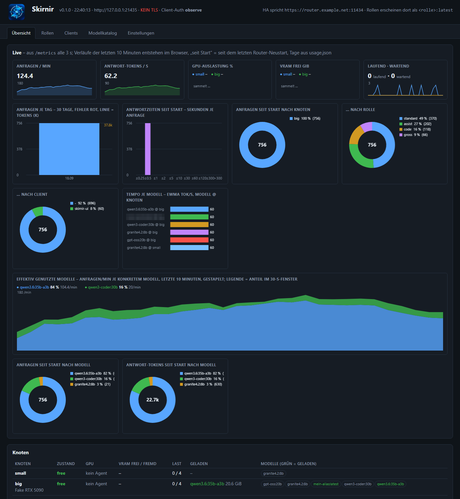

# Operations

**English** · [Deutsch](operations.de.md) · [README](../README.md)

## Web UI



*Overview in the local development environment (`test/dev_env.py`) with two fake nodes and synthetic traffic. The UI is available in English and German (toggle in the header).*

`https://<name>:11435/`, login with a user from `control_auth.users`. One page ([router/ui.html](../router/ui.html) with its script [router/ui.js](../router/ui.js) and styles [router/ui.css](../router/ui.css), no inline script or style), no
external libraries, six tabs:

- **Overview:** the active **problems** (severity, code and text in the UI language, [below](#problems));
  nodes with state, breaker, GPU, VRAM, load and loaded models; cloud providers with budget bars; operations tiles; recent decisions; **live charts** (canvas from `/metrics`): requests/min,
  tokens/s, GPU and VRAM per node, daily history, latency histogram, shares by node/role/client, effectively used models.
- **Agents:** registered agents with facts, approval, per-node policy (WOL, weight, busy thresholds, GPU guard, MQTT,
  auto-update), the staged agent version and the update state; a dot on the tab while an agent waits for approval.
- **Roles:** tier editor with priority, canary, shadow; **Try** (role or model, num_ctx, execution, data class, priority, think)
  with node, tier, reason, skipped tiers, duration split into queue / model / router; **load test** (n requests with concurrency c,
  plus probes with `interactive`).
- **Clients:** one card per client, generate and rotate secrets, source IPs, roles, limits.
- **Model catalogue:** weights, context cost, VRAM need, speed, capabilities, measure and benchmark; cloud models with prices.
- **Settings:** everything the router reads at runtime (allowlist in [settings.py](../router/skirnir_router/settings.py)), with the
  config.yaml value, changed values marked, and reset.

Look at it locally without real nodes: `python test/dev_env.py` starts fake nodes, fake cloud, fake agent and the router without
TLS and login at `http://127.0.0.1:21435/`.

To quiet a single node for a measurement (no unloading or prewarming until a given time): `POST /admin/nodes/{fp}/quiet`,
ended early with `DELETE` ([ADR-0061](adr/0061-quiet-a-single-node-for-a-measurement.md); endpoints in
[reference.md](reference.md#interfaces)).

## Observability

`GET /metrics` (control port, Basic Auth) returns Prometheus text without `prometheus_client`, prefix `skirnir_`:
`requests_total{role,node,model,client,via,outcome}`, `tokens_total{kind,…}`, histograms `request_duration_seconds`,
`ttft_seconds`, `queue_wait_seconds`, `events_total{event,node}`, per node `node_up`, `node_state`, `node_inflight`,
`node_gpu_util_percent`, `node_vram_*_gib`, `node_breaker`, per model `model_loaded_gib`, `perf_gen_tps`, `perf_error_rate`,
plus `decision_*`, `cloud_*`, `usage_today_*`, `info`, and the active problems as `problem{code,severity,node,subject}` and
`problems_active` ([below](#problems)).

```yaml
scrape_configs:
  - job_name: skirnir
    scheme: https
    metrics_path: /metrics
    basic_auth: { username: metrics, password_file: /etc/prometheus/skirnir.pass }
    static_configs: [{ targets: ["router.example.net:11435"] }]
```

`usage.json` keeps requests, tokens, errors and cloud costs per day and client for 90 days (`GET /admin/usage`). The counters
and histograms behind `/metrics` persist in `metrics.json` next to the configuration (written a minute after a change and at
shutdown), so a deploy no longer resets them; the UI labels them 'total' since the recording began. For history over days
and weeks point a Prometheus at `/metrics` (scrape config above); the router is not a time-series database.
[monitoring/](../monitoring/) ships exactly that: Prometheus with 90 days of retention and a Grafana dashboard as two
containers on the router host.

The decision log (`/admin/state`, last 2000 entries, persisted in `events.jsonl` next to the configuration so it survives
restarts; `?decisions=N` selects how many are returned, default 50) holds the most recent routes and events (busy/free, WOL,
breaker, queue, shadow, decision). `/admin/state` also shows `build` (deploy manifest) and `supply_chain` (Ollama version and
model digests per node). Refused and limited requests are in the audit log (`client_auth.audit_log`).

### Problems

Conditions the operator should act on while the router keeps serving (router 0.35.0,
[ADR-0101](adr/0101-problems-are-structured-records-exported-as-metrics.md)). They are computed without MQTT and reach
every channel from the same list: `GET /admin/problems[?lang=de|en]` (control port, Basic Auth; records with `code`,
`severity`, `node`, `subject`, `params`, `message`), the web UI overview, `/metrics` and the Home Assistant attribute
`problems`.

| Code | Severity | When |
|---|---|---|
| `no_node_online` | critical | No node is online. |
| `role_not_servable` | critical | No online node could serve the role (`subject`), not even when free; a role that waits only for a busy node is not a problem. |
| `agent_heartbeat_missing` | warning | The node's agent reported before and has been silent longer than `router.agent_missing_problem_s`. |
| `ram_spill` | warning | A loaded model (`subject`) has at least `router.ram_spill_problem_gib` in system RAM. |
| `gpu_guard` | warning | The agent reports a GPU guard problem (unavailable, deselected, hardware warning) and the router considers the guard. Never for a node without a GPU (`gpu_present: false`, ADR-0102). |
| `agent_update_failed`, `agent_update_stalled` | warning | An agent update failed or has not reported for too long. |
| `ollama_update_failed`, `ollama_update_stalled` | warning | The same for an Ollama update. |
| `ollama_version_check_failing` | warning | The Ollama version check has failed for three days (or never succeeded). |
| `cloud_budget_warning` | warning | A provider (`subject`) is above `warn_at_percent` of its monthly budget. |
| `cloud_budget_exhausted` | critical | A provider's monthly budget is used up; it drops out as a tier. |

`critical` means requests fail or a configured tier drops out now; `warning` means the router still serves, but slower,
without a safety function or without fresh facts. In `/metrics`, `skirnir_problem` has one series per active problem
(value 1, or the number of problems with the same labels) and none while there is nothing; an empty `node` or `subject`
means none. Labels never carry free text; the values behind the message (minutes, GiB, an agent's error) are in
`/admin/problems`. An alert rule without Home Assistant:

```yaml
groups:
  - name: skirnir
    rules:
      - alert: SkirnirProblem
        expr: skirnir_problem > 0
        for: 5m
        annotations: { summary: "{{ $labels.code }} {{ $labels.node }} {{ $labels.subject }}" }
```

## Home Assistant entities

Home Assistant is optional. Without an `mqtt:` section, or without `paho-mqtt` installed, the router publishes nothing. Routing,
the UI, `/admin/*`, `/metrics` and every fact the agents report work the same way: GPU, game, memory, sleep. The agent's own MQTT
device is optional as well (`mqtt:` in the agent configuration). The router publishes over MQTT with TLS (port 8883), the
password comes from `secrets.env`. A router installed with `install.sh --without-mqtt` has no MQTT library and publishes nothing
either; install again without the option before adding an `mqtt:` section (the script refuses the option while one is set).

The router registers via MQTT discovery as the device **Skirnir**: sensors for nodes online/busy, available models, ready roles
(attribute: which node and model would be chosen right now), requests and tokens today, cloud costs this month, last assignment,
per node state / GPU utilisation / free VRAM, a `binary_sensor` **Problem** with attribute `problems` (the texts of the
[problems](#problems) in `router.problem_language`: `de` by default, the sentences automations have matched since router
0.1, or `en`) and a sensor **Node awaiting approval** for new agents. Last will
`ollama-router/status=offline` (the MQTT topic and entity ids keep the old name on purpose); missing readings are `unavailable`,
not `unknown`. Node entities are kept in sync: blocked or deleted nodes disappear from Home Assistant, even if they vanished
during a router restart. Connecting Home Assistant as a client: [clients.md](clients.md#home-assistant).

**Slowness signals** (router 0.9.2). Nothing fails when a model runs slowly, so these are reported as facts per node:
`binary_sensor.skirnir_node_<node>_ram_spill` **Model partly in RAM** is on while Ollama has placed part of a loaded model in
system RAM (`/api/ps`: `size` larger than `size_vram`; those layers run on the CPU, every request is many times slower), with the
models and GiB as attributes; from `router.ram_spill_problem_gib` (0.5 GiB, 0 = off) it is also a **Problem**.
`sensor.skirnir_node_<node>_gen_tps` and `_prompt_tps` carry the generation and prompt rate (tok/s) of the last warm request on
the node, with the model as attribute; a reply under 20 tokens or a prompt under 200 new tokens does not count, nor do
benchmarks. New tokens are those Ollama did not serve from its prompt cache (`prompt_eval_cached_count`, router 0.34.1,
[ADR-0100](adr/0100-the-prompt-rate-counts-only-the-tokens-ollama-processed.md)); the prompt rate is computed over them, and a
node whose Ollama does not report the cached part sends no prompt rate. Their raw values are meant for a baseline in Home
Assistant (e.g. a statistics helper with the median of a week).

## Agent updates and rollout

Agents update themselves through the router. The binaries come with a manifest signed by an operator key (never by the router);
agents pull them through their outbound connection, verify signature and hash, swap themselves and restart. Publishing a
release:

- with the standalone tool: `python deploy/agent_keys.py --keys <folder> sign-release <dist> --version <v>` writes the manifest
  and the release-named binaries (`skirnir-agent-<version>-linux-amd64`, `skirnir-agent-<version>-windows-amd64.exe`) to copy
  to `/etc/skirnir-router/agent/` on the router ([ADR-0068](adr/0068-standalone-agent-key-and-release-tool.md));
- in the maintainer's deploy environment: `deploy.py --agent` places them on the router directly.

Then a button per node in the web UI, or the rollout loop with a per-node policy and a canary node that gets new versions first
(`modes.agent_update`: `canary`, `canary_clean_h`). Failures and stalls become Home Assistant problems.

An agent refuses a signed version older than the one it runs (update kind `downgrade`); a deliberate rollback needs
`update.allow_downgrade: true` in the node's own configuration
([ADR-0054](adr/0054-agent-refuses-signed-downgrades.md)). Windows with Smart App Control blocks unsigned binaries, so the
release binary is Authenticode-signed after the build (`agent/sign.ps1`; `deploy.py --agent` refuses an unsigned binary once a
signing thumbprint is configured).

## Verifying a release

When a release is published, the workflow *Release provenance* rebuilds the agent binaries from the tag (clean export of
`agent/`, the Go toolchain recorded in the published binary, CGO off, `-trimpath`) and compares them byte for byte with
the release assets. Only if they are identical does GitHub attest their build provenance, and the release gets CycloneDX
SBOMs: one per agent binary (Go toolchain, modules with `go.sum` hashes, build settings) and one for the router's Python
requirements (`skirnir-router-<version>.cdx.json`). A difference fails the workflow with both hashes (ADR-0075). A release
that ships the agent of an earlier release is rebuilt from the release that first published that agent version when its
own tag does not reproduce it (for example after a dependency bump in `agent/` without a new agent); the run's summary
names the source (ADR-0141). To check a downloaded binary:

```bash
gh attestation verify skirnir-agent-<version>-windows-amd64.exe --repo psewar/skirnir
```

The router is released as source. The same workflow attaches `skirnir-router-<version>.tar.gz`, the `router/` folder of
the tag as `git archive` writes it, and attests its build provenance (ADR-0139). To install from it instead of a clone:

```bash
gh attestation verify skirnir-router-<version>.tar.gz --repo psewar/skirnir
tar -xzf skirnir-router-<version>.tar.gz && sudo bash skirnir-router-<version>/router/install.sh
```

The operator's Ed25519 signature on the update manifest stays the trust anchor of the agents' self-update; the
attestation shows that the published bytes come from the tagged source. For an earlier release, start the workflow by
hand with its tag.

## Ollama updates

Router 0.3.0, agent 0.12.0. Once Ollama runs as a child of the agent service, the tray app's own updater no longer applies (it
runs under the desktop user, and the installer is per-user). The router checks the latest Ollama release every few hours and
shows it per node in the *Agents* tab; a per-node policy *Ollama auto-update* lets the rollout loop update nodes inside a night
window (`modes.ollama_update`, default 02:00 to 05:00 router local time), canary first, only when the node is free. The agent
downloads the release archive (`ollama.exe` plus `lib/ollama`, no installer) from its own fixed source and verifies it against
the release's `sha256sum.txt` while Ollama keeps serving requests. Only then does it report *ready*; the router takes the node
out of routing, waits until no request is running and releases the swap (agent 0.15.0). The agent stops Ollama, swaps the
files, restarts it and rolls back if the new version does not answer. While an update runs the router does not prewarm the
node, and it prewarms once when the update is done. The router therefore chooses only the version, never the code, and
since agent 0.31.0 no older version: an order below the installed Ollama (or a pre-release) is refused unless the node's
configuration sets `ollama_update.allow_downgrade: true` for a deliberate rollback (ADR-0073). Windows nodes only for now;
Linux archives are tar.zst.

**Release source** (router 0.41.0, ADR-0117): `modes.ollama_update.release_source` selects where the router learns the
latest version. `github` (default) reads the GitHub API at `release_url` as before. `document` reads a neutral release
document at `release_url`, for example from a mirror or an internal repository without GitHub access:

```json
{"version": "0.35.1",
 "files": {"windows/amd64": {"url": "https://mirror.example.net/ollama/v0.35.1/ollama-windows-amd64.zip",
                             "sha256": "<64 hex digits>", "size": 1900000000}}}
```

The rules are strict (ADR-0124): final HTTPS URL (plain HTTP only to `127.0.0.1`/`::1`), no redirect, at most 64 KiB,
20 s, `version` in the agent's version grammar, `sha256` with 64 hex digits, `size` in bytes, and every `url` ends in the
archive name the agent expects for that platform. Platforms without an agent archive are skipped; a malformed entry for a
known platform discards the whole document and the router keeps the last known version (problem `ollama_version_check_failing`
after three days without a successful check). The document names only the version and the expected hashes. The agent still downloads from
its own source `ollama_update.source` in the layout `<source>v<version>/<archive>` and `<source>v<version>/sha256sum.txt`
and refuses an order whose hash does not match that source's `sha256sum.txt`. For a mirror both sides therefore point at it:
the router at the document, each agent with `ollama_update.source` at the directory. Nothing changes on the agent.

**Waking in the log:** every wake attempt appears in the decision log as event `wol` with the field `waker` (`wol` or the
name from `router.wakers`); the journal writes `WOL <node> (<mac>)` or `wake via <waker> <node> (<host> HTTP <status>)`. If a
waker could not send anything, it writes `wake <node> via <waker>: ... (<kind>)` with a fixed kind: `wake_no_mac`,
`wake_send_failed`, `wake_unknown_waker`, `wake_secret_missing`, `wake_unreachable`, `wake_redirect`, `wake_refused`; the
router then does not wait but answers 503 at once. Configuration: [configuration.md](configuration.md#waking-nodes).

## Secrets renderer

`render-env.sh` renders `secrets.env` before every router start (`skirnir-router-secrets.service`) and, with the optional
timer, daily (`skirnir-router-secrets-refresh.service`, restarts the router when the file changed). Its output is in the
journal: `journalctl -u skirnir-router-secrets -u skirnir-router-secrets-refresh`. Every run ends with a state line
([install-router.md](install-router.md#secrets), ADR-0104):

| State | Meaning | Next step |
|---|---|---|
| `STATE: written` | The file was replaced; the line before names how many of the names were present. | None. Names reported as `missing in the source` are simply not in the file. |
| `STATE: unchanged` | Same content as before. | None. |
| `STATE: kept` | The existing file stays: the source is not ready (`secret store not reachable`, `refused the login (HTTP ...)`, `SECRET_FILE ... missing`), a name could not be fetched (`fetch failed (...)`; nothing is dropped because of a transient fault), or the source holds none of the names. | Fix what the line above names; the next run or `systemctl start skirnir-router-secrets` renders again. To empty the file on purpose, delete it by hand. |
| `STATE: not-configured` | No `render-env.conf`: `secrets.env` is maintained by hand. | None, or set up a source. |
| `STATE: refused` | `render-env.conf`, `SECRET_STORE_AUTH_FILE` or `SECRET_FILE` failed a check (owner, mode, a path the router may write), the configuration is incomplete, or `SECRET_SOURCE` is unknown. | Fix the file the line above names. |

A value with a line break is never written (it would start a further variable in the router unit's environment); the name
is reported and skipped. No secret value appears in the output.

## Key rotation

The agent signing key can be rotated without a gap ([ADR-0058](adr/0058-rotate-the-agent-signing-key-with-several-trusted-keys.md)):

1. Create the next key: `python deploy/agent_keys.py --keys <folder> next` (or `deploy.py --new-agent-key`); it prints the
   public part.
2. Add it to `update.public_keys` on every node. On Windows nodes `agent\Set-UpdateKey.cmd -Step Add -Key <public key>` does
   this as administrator, with backup, `check-config` and rollback.
3. Switch signing: `python deploy/agent_keys.py --keys <folder> use-next` (or `deploy.py --use-next-agent-key`); the old key is kept as retired.
4. Let every node install a release signed with the new key. A node that does not trust it yet keeps its binary and reports an
   invalid manifest signature.
5. Remove the old public key from the nodes: `Set-UpdateKey.cmd -Step Complete -Key <new public key>` (the new key becomes
   `update.public_key`).

**Lost signing key** ([ADR-0066](adr/0066-explicit-agent-key-creation-and-lost-key-recovery.md)): `python deploy/agent_keys.py --keys <folder>
replace-lost "<reason>"` (or `deploy.py --replace-lost-agent-key "<reason>"`) creates a new key with a record, and every node needs
`Set-UpdateKey.cmd -Step Replace -Key <new public key>` (on Linux: set `update.public_key` by hand) before it accepts a release
again. Neither tool creates a key implicitly: `create` (or `deploy.py --create-agent-key`) is for a new installation only.

## What to back up

Skirnir has no backup function of its own; back up these files with the tool you already use. Paths are the defaults of
`install.sh` and the agent's `setup`; a different `--config-dir`, `router.state_dir` or `identity.dir` moves them.

**Router**

| What | Default path | Why |
|---|---|---|
| Configuration folder | `/etc/skirnir-router/` | `config.yaml` (written by root tools, never by the router), the certificates in `certs/` (or `tls/` on older installations) and the release folder `agent/` (`manifest.json` and the signed agent binaries; these can also be copied again from a release). |
| Source of the secrets | your secret store, and `/etc/skirnir-router-secrets/render-env.conf` with its access (with `SECRET_SOURCE=file`: the file `SECRET_FILE` names instead of the store) | `secrets.env` is rendered from it and can be rendered again: back up the source, not the rendered file. If you maintain `secrets.env` by hand, it is the source. The access file holds a credential; keep its backup as protected as the file itself. |
| State folder (`router.state_dir`) | `/var/lib/skirnir-router/` | Everything the router writes itself, see the next table. Without `state_dir` these files lie next to `config.yaml`. |
| Session database (optional) | the PostgreSQL database or the SQLite file that `SKIRNIR_SESSION_DSN` (`session_store.dsn_env`) names (ADR-0114) | Sessions (events, managed turns, compactions, handoff imports) and the memory outbox. PostgreSQL: back it up with its own tools. SQLite: see `sessions.db` below. |
| Memory backend (optional) | outside Skirnir (Hindsight) | The long-term memory lives there; back it up as that service documents. |
| Logs | `/var/log/skirnir-router/` | `audit.jsonl` (`client_auth.audit_log`) and, with `audit_log_max_mib`, its rotated generations `audit.jsonl.1` ... (ADR-0132), if you need the audit trail. |

Files in the state folder:

| File | Content | If it is lost |
|---|---|---|
| `nodes.json` | node registry: each agent's public key, approval state, policy and facts | every node shows up as pending and has to be approved again |
| `roles.yaml` | what the web UI changed: roles, models, settings, clients added in the UI (token hashes) | the UI changes are gone; `config.yaml` applies alone |
| `deletions.jsonl` | deletion journal, ids only (ADR-0076) | a restored database brings deleted sessions and memory back; see below |
| `sessions.db` (with `sqlite:///sessions.db`; the name is yours) | the SQLite session store: session content and the memory outbox, owner-only (0600). While the router runs, copy it only with `sqlite3 sessions.db ".backup /backup/sessions.db"`; a plain copy can miss what is still in `sessions.db-wal`. Stopped, a plain copy of the file is enough | stored sessions and pending memory jobs are gone; the router creates an empty store |
| `usage.json` | usage per client and month, including the cloud spend per provider | the monthly cloud budget starts again at zero |
| `metrics.json`, `perf.json` | cumulative counters; measured speed per model and node for the catalog | counters and speed values start from scratch |
| `events.jsonl` | the event and decision log the web UI shows | history only |
| `requests.jsonl` | decision observation (`decision_engine.observe_all`) | observation data only |
| `ollama-latest.json` | last known Ollama release | nothing, it is fetched again |

The opt-in decision capture writes to its own path (`decision_engine.capture.path`, default
`/var/lib/skirnir-router/decisions.jsonl`), inside the state folder by default.

**Nodes and operator**

| What | Default path | Why |
|---|---|---|
| Agent configuration | Windows `C:\ProgramData\skirnir-agent\config.yaml`, Linux `/etc/skirnir-agent/config.yaml` | router URL, `update.public_key(s)`, children and local settings |
| Agent identity | the `identity.dir`: Windows `C:\ProgramData\skirnir-agent\identity\`, Linux (after `setup`) `/var/lib/skirnir-agent/identity/` | `agent-identity.key` is the node's identity towards the router; `provisioned.json` is the last bundle from the router and comes again on the next connection. On Windows both are DPAPI-protected for the machine and can only be restored onto the same Windows installation; after a reinstall the agent creates a new key and the node is approved again. |
| Update signing key | the operator's key folder (`deploy/agent_keys.py --keys <folder>`), off the router | `agent-update.key`, a prepared `agent-update.next.key` and the retired keys. Without it no node accepts a new release until every node trusts a replacement (see [Key rotation](#key-rotation), lost signing key). Keep the backup offline and encrypted. |

## Restoring a backup

Deletions are recorded outside the database, ids only, in `deletions.jsonl` in the router's state folder
(`router.state_dir`, otherwise next to `config.yaml`; ADR-0076):

1. **Session database restored** (PostgreSQL, or the SQLite file copied back with the router stopped and its `-wal` and
   `-shm` files removed): start the router as usual. Before the memory outbox sends
   anything it applies the journal again; the log says how many sessions and operations were back and are deleted again.
   Restore `deletions.jsonl` never older than the database - keep it out of the database restore.
2. **Hindsight restored**: documents of deleted memory operations are back. Delete them again, page by page:

   ```bash
   curl -u admin -X POST https://<router>:11435/admin/memory/reconcile-deletions -H 'Content-Type: application/json' \
     -d '{"after": "00000000-0000-0000-0000-000000000000", "limit": 500}'
   ```

   Repeat with `"after": <next>` until `next` is null. `unavailable` counts documents Hindsight did not answer for; run
   again later.
3. Watch `skirnir_memory_deletions_stuck`: deletions whose job ended dead or revoked need a look.

## Names

Since router 0.2.0 / agent 0.11.0 the technical names follow the product: package `skirnir_router`, service and paths
`skirnir-router` (`/opt/skirnir-router`, `/etc/skirnir-router`), agent binary `skirnir-agent`, Windows service `SkirnirAgent`
("Skirnir Agent"). `deploy.py` moves an existing router installation once (directories, units), and the agent's `setup`
migrates an existing node (directories, service, relay task). An agent that updated itself under the old file name keeps
working: old configuration path, service and task names are found as fallbacks until `setup` has run. The MQTT side moved
too: base topic `skirnir-router`, discovery node id `skirnir_router`, unique ids `skirnir_router_*`, entity ids
`<domain>.skirnir_*` (English since router 0.9.0 via `default_entity_id`, see
[design/english-names.md](../design/english-names.md)); the router clears the retained topics of the old names on its first
connect. Home Assistant keeps entity registry entries per unique id, so custom entity ids of the old entities have to be
carried over once (an operator script does that over the WebSocket API); recorder history does not carry over.

## Measurements as a reference

VRAM need according to the formula in [configuration.md](configuration.md#roles-and-tiers), measured on a 32 GB GPU (31.8 GiB
usable, KV cache f16, Ollama 0.33/0.34); speed from the UI benchmark (200 tokens, temperature 0, median of two runs, context 8k).

| Model | Weights GiB | Context cost MiB/1k | VRAM @8k / @32k / @64k GiB | gen tok/s | prompt tok/s | Capabilities |
|---|---|---|---|---|---|---|
| qwen3.6:35b-a3b | 20.6 | 1 | 21.4 / 21.4 / 21.5 | 254 | 1219 | vision, tools, thinking |
| qwen3-coder:30b | 17.3 | 98 | 18.9 / 21.2 / 24.2 | 285 | 5964 | tools |
| glm-4.7-flash | 17.7 | 50 | 18.9 / 20.1 / 21.7 | 224 | 10689 | tools, thinking |
| granite4.2:30b | 16.8 | 248 | 19.5 / 25.3 / 33.1 ✗ | 76 | 3478 | tools, thinking |
| gemma4:26b | 16.1 | 12 | 17.0 / 17.3 / 17.7 | 233 | 1822 | vision, tools, thinking |
| gpt-oss:20b | 12.0 | 2 | 12.8 / 12.8 / 12.9 | 270 | 6712 | tools, thinking (no `structured`) |
| gemma4:12b (smaller second GPU) | 7.8 | 2 | 8.6 / 8.6 / 8.7 | 71 | 1277 | vision, tools, thinking |
| granite4.2:8b | 5.0 | 162 | 7.0 / 10.8 / 15.9 | 213 | 7919 | tools, thinking |

Models with hybrid attention (qwen3.6, gemma4, gpt-oss) cost practically no VRAM per context token; granite and the coder models
pay noticeably. Thinking models produce invisible reasoning tokens unless `think: false` is set – the response time is then no
measure of speed. Re-measure when Ollama, driver or KV cache type change.
