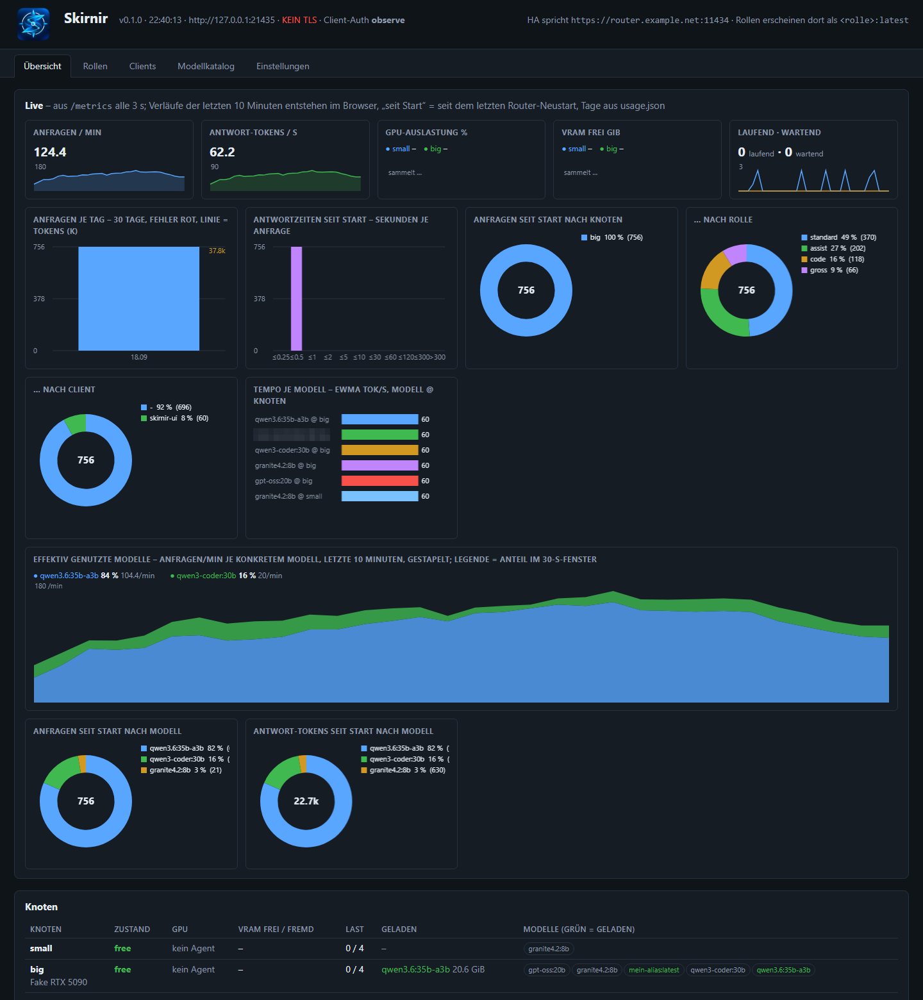

# Operations

**English** · [Deutsch](operations.de.md) · [README](../README.md)

## Web UI



*Overview in the local development environment (`test/dev_env.py`) with two fake nodes and synthetic traffic. The UI is available in English and German (toggle in the header).*

`https://<name>:11435/`, login with a user from `control_auth.users`. One page ([router/ui.html](../router/ui.html)), no
external libraries, six tabs:

- **Overview:** nodes with state, breaker, GPU, VRAM, load and loaded models; cloud providers with budget bars; operations tiles; recent decisions; **live charts** (canvas from `/metrics`): requests/min,
  tokens/s, GPU and VRAM per node, daily history, latency histogram, shares by node/role/client, effectively used models.
- **Agents:** registered agents with facts, approval, per-node policy (WOL, weight, busy thresholds, GPU guard, MQTT,
  auto-update), the staged agent version and the update state; a dot on the tab while an agent waits for approval.
- **Roles:** tier editor with priority, canary, shadow; **Try** (role or model, num_ctx, execution, data class, priority, think)
  with node, tier, reason, skipped tiers, duration split into queue / model / router; **load test** (n requests with concurrency c,
  plus probes with `interactive`).
- **Clients:** one card per client, generate and rotate secrets, source IPs, roles, limits.
- **Model catalogue:** weights, context cost, VRAM need, speed, capabilities, measure and benchmark; cloud models with prices.
- **Settings:** everything the router reads at runtime (allowlist in [settings.py](../router/skirnir_router/settings.py)), with the
  config.yaml value, changed values marked, and reset.

Look at it locally without real nodes: `python test/dev_env.py` starts fake nodes, fake cloud, fake agent and the router without
TLS and login at `http://127.0.0.1:21435/`.

To quiet a single node for a measurement (no unloading or prewarming until a given time): `POST /admin/nodes/{fp}/quiet`,
ended early with `DELETE` ([ADR-0061](adr/0061-quiet-a-single-node-for-a-measurement.md); endpoints in
[reference.md](reference.md#interfaces)).

## Observability

`GET /metrics` (control port, Basic Auth) returns Prometheus text without `prometheus_client`, prefix `skirnir_`:
`requests_total{role,node,model,client,via,outcome}`, `tokens_total{kind,…}`, histograms `request_duration_seconds`,
`ttft_seconds`, `queue_wait_seconds`, `events_total{event,node}`, per node `node_up`, `node_state`, `node_inflight`,
`node_gpu_util_percent`, `node_vram_*_gib`, `node_breaker`, per model `model_loaded_gib`, `perf_gen_tps`, `perf_error_rate`,
plus `decision_*`, `cloud_*`, `usage_today_*`, `info`.

```yaml
scrape_configs:
  - job_name: skirnir
    scheme: https
    metrics_path: /metrics
    basic_auth: { username: metrics, password_file: /etc/prometheus/skirnir.pass }
    static_configs: [{ targets: ["router.example.net:11435"] }]
```

`usage.json` keeps requests, tokens, errors and cloud costs per day and client for 90 days (`GET /admin/usage`). The counters
and histograms behind `/metrics` persist in `metrics.json` next to the configuration (written a minute after a change and at
shutdown), so a deploy no longer resets them; the UI labels them 'total' since the recording began. For history over days
and weeks point a Prometheus at `/metrics` (scrape config above); the router is not a time-series database.
[monitoring/](../monitoring/) ships exactly that: Prometheus with 90 days of retention and a Grafana dashboard as two
containers on the router host.

The decision log (`/admin/state`, last 2000 entries, persisted in `events.jsonl` next to the configuration so it survives
restarts; `?decisions=N` selects how many are returned, default 50) holds the most recent routes and events (busy/free, WOL,
breaker, queue, shadow, decision). `/admin/state` also shows `build` (deploy manifest) and `supply_chain` (Ollama version and
model digests per node). Refused and limited requests are in the audit log (`client_auth.audit_log`).

## Home Assistant entities

Home Assistant is optional. Without an `mqtt:` section, or without `paho-mqtt` installed, the router publishes nothing. Routing,
the UI, `/admin/*`, `/metrics` and every fact the agents report work the same way: GPU, game, memory, sleep. The agent's own MQTT
device is optional as well (`mqtt:` in the agent configuration). The router publishes over MQTT with TLS (port 8883), the
password comes from `secrets.env`.

The router registers via MQTT discovery as the device **Skirnir**: sensors for nodes online/busy, available models, ready roles
(attribute: which node and model would be chosen right now), requests and tokens today, cloud costs this month, last assignment,
per node state / GPU utilisation / free VRAM, a `binary_sensor` **Problem** with attribute `problems` (no node online, role not
servable, agent silent, budget warning) and a sensor **Node awaiting approval** for new agents. Last will
`ollama-router/status=offline` (the MQTT topic and entity ids keep the old name on purpose); missing readings are `unavailable`,
not `unknown`. Node entities are kept in sync: blocked or deleted nodes disappear from Home Assistant, even if they vanished
during a router restart. Connecting Home Assistant as a client: [clients.md](clients.md#home-assistant).

**Slowness signals** (router 0.9.2). Nothing fails when a model runs slowly, so these are reported as facts per node:
`binary_sensor.skirnir_node_<node>_ram_spill` **Model partly in RAM** is on while Ollama has placed part of a loaded model in
system RAM (`/api/ps`: `size` larger than `size_vram`; those layers run on the CPU, every request is many times slower), with the
models and GiB as attributes; from `router.ram_spill_problem_gib` (0.5 GiB, 0 = off) it is also a **Problem**.
`sensor.skirnir_node_<node>_gen_tps` and `_prompt_tps` carry the generation and prompt rate (tok/s) of the last warm request on
the node, with the model as attribute; a reply under 20 tokens or a prompt under 200 new tokens does not count, nor do
benchmarks. Their raw values are meant for a baseline in Home Assistant (e.g. a statistics helper with the median of a week).

## Agent updates and rollout

Agents update themselves through the router. The binaries come with a manifest signed by an operator key (never by the router);
agents pull them through their outbound connection, verify signature and hash, swap themselves and restart. Publishing a
release:

- with the standalone tool: `python deploy/agent_keys.py --keys <folder> sign-release <dist> --version <v>` writes the manifest
  and the release-named binaries (`skirnir-agent-<version>-linux-amd64`, `skirnir-agent-<version>-windows-amd64.exe`) to copy
  to `/etc/skirnir-router/agent/` on the router ([ADR-0068](adr/0068-standalone-agent-key-and-release-tool.md));
- in the maintainer's deploy environment: `deploy.py --agent` places them on the router directly.

Then a button per node in the web UI, or the rollout loop with a per-node policy and a canary node that gets new versions first
(`modes.agent_update`: `canary`, `canary_clean_h`). Failures and stalls become Home Assistant problems.

An agent refuses a signed version older than the one it runs (update kind `downgrade`); a deliberate rollback needs
`update.allow_downgrade: true` in the node's own configuration
([ADR-0054](adr/0054-agent-refuses-signed-downgrades.md)). Windows with Smart App Control blocks unsigned binaries, so the
release binary is Authenticode-signed after the build (`agent/sign.ps1`; `deploy.py --agent` refuses an unsigned binary once a
signing thumbprint is configured).

## Verifying a release

When a release is published, the workflow *Release provenance* rebuilds the agent binaries from the tag (clean export of
`agent/`, the Go toolchain recorded in the published binary, CGO off, `-trimpath`) and compares them byte for byte with
the release assets. Only if they are identical does GitHub attest their build provenance, and the release gets CycloneDX
SBOMs: one per agent binary (Go toolchain, modules with `go.sum` hashes, build settings) and one for the router's Python
requirements (`skirnir-router-<version>.cdx.json`). A difference fails the workflow with both hashes (ADR-0075). To check
a downloaded binary:

```bash
gh attestation verify skirnir-agent-<version>-windows-amd64.exe --repo psewar/skirnir
```

The operator's Ed25519 signature on the update manifest stays the trust anchor of the agents' self-update; the
attestation shows that the published bytes come from the tagged source. For an earlier release, start the workflow by
hand with its tag.

## Ollama updates

Router 0.3.0, agent 0.12.0. Once Ollama runs as a child of the agent service, the tray app's own updater no longer applies (it
runs under the desktop user, and the installer is per-user). The router checks the latest Ollama release every few hours and
shows it per node in the *Agents* tab; a per-node policy *Ollama auto-update* lets the rollout loop update nodes inside a night
window (`modes.ollama_update`, default 02:00 to 05:00 router local time), canary first, only when the node is free. The agent
downloads the release archive (`ollama.exe` plus `lib/ollama`, no installer) from its own fixed source and verifies it against
the release's `sha256sum.txt` while Ollama keeps serving requests. Only then does it report *ready*; the router takes the node
out of routing, waits until no request is running and releases the swap (agent 0.15.0). The agent stops Ollama, swaps the
files, restarts it and rolls back if the new version does not answer. While an update runs the router does not prewarm the
node, and it prewarms once when the update is done. The router therefore chooses only the version, never the code, and
since agent 0.31.0 no older version: an order below the installed Ollama (or a pre-release) is refused unless the node's
configuration sets `ollama_update.allow_downgrade: true` for a deliberate rollback (ADR-0073). Windows nodes only for now;
Linux archives are tar.zst.

## Key rotation

The agent signing key can be rotated without a gap ([ADR-0058](adr/0058-rotate-the-agent-signing-key-with-several-trusted-keys.md)):

1. Create the next key: `python deploy/agent_keys.py --keys <folder> next` (or `deploy.py --new-agent-key`); it prints the
   public part.
2. Add it to `update.public_keys` on every node. On Windows nodes `agent\Set-UpdateKey.cmd -Step Add -Key <public key>` does
   this as administrator, with backup, `check-config` and rollback.
3. Switch signing: `python deploy/agent_keys.py --keys <folder> use-next` (or `deploy.py --use-next-agent-key`); the old key is kept as retired.
4. Let every node install a release signed with the new key. A node that does not trust it yet keeps its binary and reports an
   invalid manifest signature.
5. Remove the old public key from the nodes: `Set-UpdateKey.cmd -Step Complete -Key <new public key>` (the new key becomes
   `update.public_key`).

**Lost signing key** ([ADR-0066](adr/0066-explicit-agent-key-creation-and-lost-key-recovery.md)): `python deploy/agent_keys.py --keys <folder>
replace-lost "<reason>"` (or `deploy.py --replace-lost-agent-key "<reason>"`) creates a new key with a record, and every node needs
`Set-UpdateKey.cmd -Step Replace -Key <new public key>` (on Linux: set `update.public_key` by hand) before it accepts a release
again. Neither tool creates a key implicitly: `create` (or `deploy.py --create-agent-key`) is for a new installation only.

## Names

Since router 0.2.0 / agent 0.11.0 the technical names follow the product: package `skirnir_router`, service and paths
`skirnir-router` (`/opt/skirnir-router`, `/etc/skirnir-router`), agent binary `skirnir-agent`, Windows service `SkirnirAgent`
("Skirnir Agent"). `deploy.py` moves an existing router installation once (directories, units), and the agent's `setup`
migrates an existing node (directories, service, relay task). An agent that updated itself under the old file name keeps
working: old configuration path, service and task names are found as fallbacks until `setup` has run. The MQTT side moved
too: base topic `skirnir-router`, discovery node id `skirnir_router`, unique ids `skirnir_router_*`, entity ids
`<domain>.skirnir_*` (English since router 0.9.0 via `default_entity_id`, see
[design/english-names.md](../design/english-names.md)); the router clears the retained topics of the old names on its first
connect. Home Assistant keeps entity registry entries per unique id, so custom entity ids of the old entities have to be
carried over once (an operator script does that over the WebSocket API); recorder history does not carry over.

## Measurements as a reference

VRAM need according to the formula in [configuration.md](configuration.md#roles-and-tiers), measured on a 32 GB GPU (31.8 GiB
usable, KV cache f16, Ollama 0.33/0.34); speed from the UI benchmark (200 tokens, temperature 0, median of two runs, context 8k).

| Model | Weights GiB | Context cost MiB/1k | VRAM @8k / @32k / @64k GiB | gen tok/s | prompt tok/s | Capabilities |
|---|---|---|---|---|---|---|
| qwen3.6:35b-a3b | 20.6 | 1 | 21.4 / 21.4 / 21.5 | 254 | 1219 | vision, tools, thinking |
| qwen3-coder:30b | 17.3 | 98 | 18.9 / 21.2 / 24.2 | 285 | 5964 | tools |
| glm-4.7-flash | 17.7 | 50 | 18.9 / 20.1 / 21.7 | 224 | 10689 | tools, thinking |
| granite4.2:30b | 16.8 | 248 | 19.5 / 25.3 / 33.1 ✗ | 76 | 3478 | tools, thinking |
| gemma4:26b | 16.1 | 12 | 17.0 / 17.3 / 17.7 | 233 | 1822 | vision, tools, thinking |
| gpt-oss:20b | 12.0 | 2 | 12.8 / 12.8 / 12.9 | 270 | 6712 | tools, thinking (no `structured`) |
| gemma4:12b (smaller second GPU) | 7.8 | 2 | 8.6 / 8.6 / 8.7 | 71 | 1277 | vision, tools, thinking |
| granite4.2:8b | 5.0 | 162 | 7.0 / 10.8 / 15.9 | 213 | 7919 | tools, thinking |

Models with hybrid attention (qwen3.6, gemma4, gpt-oss) cost practically no VRAM per context token; granite and the coder models
pay noticeably. Thinking models produce invisible reasoning tokens unless `think: false` is set – the response time is then no
measure of speed. Re-measure when Ollama, driver or KV cache type change.
