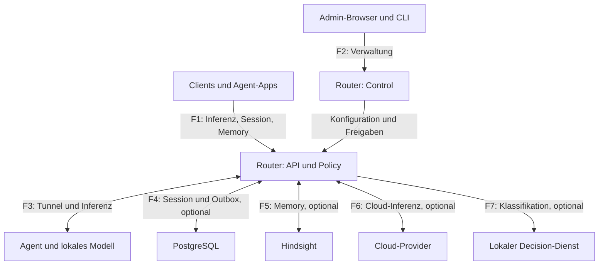

# Skirnir – Threat Model
Version 1.0 · 3. November 2026 · Status: statisches Architekturmodell, zur technischen und betrieblichen Prüfung

## 1. Ergebnis und Geltungsbereich

Skirnir ist eine zentrale Vertrauensinstanz: Der Router entscheidet über Modellzugriff und externe Datenübertragung, vermittelt Agentenverbindungen und kontrolliert optionale Sessions und Memory. Seine Kompromittierung betrifft deshalb mehrere Sicherheitsgrenzen gleichzeitig. Ein lokaler Betrieb reduziert die externe Exposition, macht Clients, Modellantworten oder gespeicherte Erinnerungen aber nicht automatisch vertrauenswürdig.

Die wichtigsten verbleibenden Risiken sind:
1. Unbeabsichtigte Cloud-Übertragung durch deklarative Klassen, optionale Inhaltsprüfung oder weitere Dienste mit eigenem Egress.
2. Missbrauch gültiger Client-/Admin-Rechte, insbesondere konkrete Modelle und schreibbare gemeinsame Memory-Bereiche.
3. Ressourcenerschöpfung vor Authentifizierung und durch lange beziehungsweise teure Inferenz.
4. Großer Schadensradius bei kompromittiertem Router, Agentenhost oder Update-Vertrauensanker.
5. Datenreste und Wiederauftauchen gelöschter Informationen bei Outbox, Backups und externem Memory.

**Bezugsstand:** Repository `psewar/skirnir`, `main` bei Commit `a41d7f50c324aa5d873dc37757c7b4154b03000c`. Die Security-Härtung aus PR #70 und die korrigierte Router-systemd-Unit sind in den gelesenen Dateien vorhanden. Frühere Review-Befunde werden nicht ungeprüft als weiterhin offen übernommen.

**Methode:** STRIDE-orientierte Modellierung anhand ausgewählter Codepfade, Designunterlagen und Security Reviews. S = Identitätstäuschung, T = Manipulation, R = Bestreitbarkeit, I = Informationsabfluss, D = Dienstverweigerung, E = Rechteausweitung.

**Grenzen:** Keine Live-Prüfung, keine Produktionskonfiguration, keine ausgeführten Regressionstests, kein vollständiger SAST-/Dependency-/History-Scan. Vorhandene Kontrollen wurden statisch gelesen; daraus folgt kein vollständiger Wirksamkeitsnachweis. Die Szenarien sind keine Behauptung, dass jeder Angriff bereits praktisch ausnutzbar ist. Dieses Dokument verändert weder Code noch Konfiguration und akzeptiert keine Risiken im Namen des Betreibers.

## 2. Schutzgüter und Sicherheitsziele

| Schutzgut | Ziel |
| --- | --- |
| Prompts, Bilder, Tool-Ergebnisse, Antworten | Nur autorisierte Clients und freigegebene Verarbeitungsziele erhalten Inhalte. |
| Sessions, Checkpoints, Compactions, Handoffs | Eigentümer- und Projektgrenzen bleiben bei Lesen, Schreiben, Export, Import und Löschung wirksam. |
| Private und gemeinsame Memory-Banken | Bankwahl erfolgt serverseitig; Lese-, Schreib- und Löschrechte bleiben getrennt. |
| Client-Tokens, Admin-Zugang, Provider-/Backend-Schlüssel | Keine Ausgabe in Antworten, Logs oder Artefakten; begrenzte Reichweite und widerrufbare Zugänge. |
| Agentenidentität und Update-Schlüssel | Nur genehmigte Knoten verarbeiten Daten; nur freigegebene Software wird installiert. |
| Router-/Agentenhosts, GPU, Datenbank, Budget | Begrenzter Ressourcenverbrauch; kontrollierter Ausfall und Wiederanlauf. |
| Audit, Provenienz, Idempotenz- und Löschledger | Sicherheitsentscheidungen sind nachvollziehbar, ohne unnötige Inhaltsprotokollierung. |

## 3. Annahmen und Angreifer

Das Modell betrachtet drei Betriebsprofile: isoliertes Einzelbetreibersystem, System mit mehreren unterschiedlich vertrauenswürdigen Clients und System mit extern erreichbaren Schnittstellen. Die Exposition beeinflusst die Priorität; eine tatsächliche private Netztopologie wird nicht vorausgesetzt oder dokumentiert.

Angreifer können sein:
- Nicht authentifizierte Netzteilnehmer oder eine fremde Webseite im Browser eines Administrators.
- Ein kompromittierter Client mit gültigem Token und regulären Projekt-/Memory-Rechten.
- Ein noch nicht genehmigter oder bereits genehmigter, kompromittierter Agent.
- Ein kompromittierter Inferenz-, Memory- oder Cloud-Dienst.
- Ein lokaler Prozess auf Router/Agent, ein privilegierter Insider oder ein kompromittierter Build-/Release-Zugang.
- Ein Urheber bösartiger Inhalte, die durch Prompts, Tool-Ergebnisse, Memory oder Handoffs ins Modell gelangen.

Betreiberkonfiguration und Hostadministration sind grundsätzlich vertrauenswürdig. Fehler oder Kompromittierungen dieser Instanzen werden dennoch als Schadensszenarien modelliert. Vollständig kompromittierte Hosts lassen sich nicht durch API-Scoping allein absichern.

## 4. Architektur und Datenflüsse

Die Darstellung zeigt logische Komponenten, keine konkrete Installation. Optionale Komponenten sind als solche bezeichnet.

API und Control sind logische Zugangspunkte desselben Router-Vertrauensbereichs, keine gegenseitig isolierten Prozesse.

| Grenze / Fluss | Daten und Autorität | Erforderliche Annahme |
| --- | --- | --- |
| B1 / F1: Client → Router | Inhalte, Modell-/Routingwahl, Projektalias, Token | Authentifizierung ersetzt keine Autorisierung. IP-Zuordnung ist schwächer als Credential-Identität. |
| B2 / F2: Admin → Control | Clientrechte, Knotenfreigabe, Konfiguration, Updates | Admin-Rechte sind hochprivilegiert; Browser- und Proxy-Sicherheit gehören dazu. |
| B3 / F3: Router ↔ Agent | Challenge/Identität, Metadaten, Requests, Antworten, Steueraufträge | Genehmigung bedeutet Vertrauen in den gesamten verarbeitenden Host; Telemetrie ist eine Behauptung des Agenten. |
| B4 / F4: Router ↔ PostgreSQL | Raw Events, Compactions, Checkpoints, Outbox, Ledger | DB-Administrator und Backups liegen außerhalb der API-Eigentümerisolation. |
| B5 / F5: Router ↔ Hindsight | Recall-Anfragen, gespeicherte Inhalte, Provenienz | Gateway-Rechte schützen nicht vor direktem Backend-Zugang; eigene Modellaufrufe des Backends separat kontrollieren. |
| B6 / F6: Router → Cloud | Nutzinhalt, eventuell Recall, Provider-Key | Freigabe muss am tatsächlich versandten Payload gelten; gesendete Daten lassen sich nicht zurückholen. |
| B7 / F7: Router → Klassifikator | Zu klassifizierender Text | Lokalität und Fehlerverhalten prüfen; ein Klassifikator ist keine verlässliche DLP-Grenze. |
| B8: Build/Update → Host | Agent-Binärdatei, Manifest, Ollama-Paket | Signierschlüssel, Bezugsquelle, Plattform und Version gehören zum Vertrauensanker. |
| B9: Betrieb → Infrastruktur | MQTT-Telemetrie, Logs, Metriken, Secrets, Backups | Separate ACLs, Transport- und Aufbewahrungsregeln; nicht automatisch durch Router-Auth geschützt. |

## 5. Bereits vorhandene Kontrollen

- **API:** `enforce` verweigert unbekannte Clients auch bei leerer Clientliste. `observe` bleibt permissiv. Health-Ausnahmen bestehen. Konkrete Modellnamen sind standardmäßig weiterhin erlaubt; eingeschränkte Clients benötigen `models: false`. [Q1]
- **Control:** Ohne Control-Benutzer wird Netzwerkzugriff verweigert; eine Loopback-Ausnahme bleibt. Authentifizierte mutierende `/admin/*`-Aufrufe benötigen `X-Skirnir-UI: 1`; `Sec-Fetch-Site: cross-site` wird abgewiesen. [Q1]
- **Enrollment:** Ed25519-Challenge-Response, explizite Freigabe/Widerruf, 32-KiB-Hello, höchstens 32 Pending-Knoten und sechs neue Registrierungen pro Quell-IP in 300 Sekunden; nachfolgende Router-WebSocket-Frames sind begrenzt. Das sind keine vollständigen Verbindungs-/CPU-Limits. [Q2]
- **Cloud:** Konfigurierte Clientklasse ist eine Untergrenze; ohne Clientklasse können Requests ihre Klasse deklarieren. `cloud: false` sperrt den Client. Secret-Muster und optionale lokale Inhaltsprüfung ergänzen die Policy. Die Inhaltsprüfung kann unter bestimmten Bedingungen auch für eine effektive Klasse `personal` den Cloud-Weg eröffnen. [Q3]
- **Sessions/Memory:** Credential-basierte Principals, Projekt-/Owner-Prüfungen, serverseitige Bankableitung, gesonderte Shared-Scope-Grants und erneute Autorisierung vor Memory-Versand. IP-only reicht dort nicht. [Q4]
- **Managed Context:** Laut Design lokale Inferenz, begrenzte Projektionen, Leases, unveränderliche Versionen und als unvertrauenswürdig markierter Kontext. Handoffs prüfen HMAC, Zeitfenster und Quell-/Zielberechtigungen; sie stellen keine laufende Tool-/OS-Ausführung wieder her. [Q5]
- **Updates:** Agent-Self-Update prüft Ed25519-Manifest, Plattform und Dateihash vor Ausführung. Ollama-Updates prüfen eine konfigurierte Bezugsquelle und deren Prüfsumme; das ist ein anderer Vertrauensanker. [Q6]
- **Betrieb/CI:** Router-systemd-Restriktionen bei weiterhin `User=root`; Security-Workflow mit `contents: read`, `pip-audit` und `govulncheck`. Das bestätigt die Konfiguration der Checks, nicht ihren aktuellen erfolgreichen Lauf oder die Sicherheit installierter Artefakte. [Q7]

## 6. Priorisiertes Bedrohungsregister

P1 = vor Freigabe des betroffenen exponierten/mehrbenutzerfähigen Features behandeln; P2 = zeitnah härten oder begründet akzeptieren; P3 = strukturelle Verbesserung. Prioritäten bewerten das verbleibende Szenario unter den genannten Voraussetzungen, keine numerisch gemessene Eintrittswahrscheinlichkeit.

| ID / STRIDE | Szenario und Voraussetzung | Vorhandener Schutz / verbleibendes Risiko | Priorität und Maßnahme |
| --- | --- | --- | --- |
| TM-01 S/E | Ein Netzteilnehmer erreicht die API im `observe`-Modus oder teilt eine erlaubte Proxy-/NAT-IP. | `enforce` funktioniert; `observe` und IP-Identität sind absichtlich schwächer. | P1 bei Netzexposition: `enforce`, `locked: true`, individuelle Tokens, TLS; Proxy-IP nicht als breite Clientidentität verwenden. [Q1] |
| TM-02 S/E | Ein Reverse Proxy verbindet sich lokal mit einer Control-Instanz ohne Benutzer. | Loopback-Ausnahme prüft Listener und Peer, nicht die ursprüngliche Identität hinter dem Proxy; Rückgabe erfolgt vor CSRF-Prüfung. | P1 falls so veröffentlicht: Auch hinter lokalem Proxy Control-Benutzer setzen; keine ungeschützte Control-Weiterleitung. Regression für genau diese Topologie. [Q1] |
| TM-03 T/E | Fremde Webseite löst Admin-Aktion aus; alternativ kompromittiertes gleiches Origin oder gestohlene Admin-Credentials. | Custom Header und Fetch Metadata helfen gegen Cross-Site-Forms. Sie verhindern weder XSS noch Admin-Missbrauch. | P2: restriktives CORS/Proxy-Verhalten, UI-Inhalte auf Escaping prüfen, Admin-Zugriff segmentieren; Browser-Negativtests. [Q1] |
| TM-04 E/D/I | Client mit eingeschränkten Rollen fordert direkt ein teures oder anderweitig unerwünschtes Modell an. | `models` bleibt standardmäßig true; Rollenliste allein begrenzt konkrete Namen nicht. | P1 bei unterschiedlich berechtigten Clients: `models: false`; explizite Model-Allowlist als spätere Designoption. Metadatenfilter gesondert prüfen. [Q1] |
| TM-05 I | Client deklariert sensible Inhalte als public; oder Inhaltsprüfung übersieht sie. | Clientfloor verhindert Herabstufung einer gesetzten Klasse, aber kein semantisches Erkennen. `privacy_check` ist eine bewusste Ausnahme. | P1 bei Cloud: Für absolutes Lokalitätsziel `cloud: false`; Klassen explizit setzen, Ausnahme dokumentieren. Vollständigen finalen Payload einschließlich Tools/Recall testen. [Q3] |
| TM-06 I/S | Provider-URL nutzt HTTP oder Weiterleitungen verlassen den erlaubten Vertrauensbereich. | Gelesene Config prüft Host-Allowlist, erzwingt dort aber kein HTTPS. Redirect-Gesamtverhalten wurde nicht vollständig nachgewiesen. | P1 bei externem Cloud-Egress: HTTPS-Schema erzwingen; Userinfo ablehnen; Redirects deaktivieren oder jeden Hop prüfen; Egress-Test vor Freigabe. [Q3] |
| TM-07 S/T/I | Angreifer füllt Pending-Slots oder Administrator genehmigt einen nachgeahmten Agentennamen. Ein genehmigter kompromittierter Agent liest Prompts oder fälscht Antworten/Lastdaten. | Signatur beweist Schlüsselbesitz, nicht Hostintegrität. Pending-Caps reduzieren Speicherverbrauch, erlauben aber Slotbelegung. | P2, bei sensiblen Workloads P1: Fingerprint außerhalb des Registrierungswegs prüfen; Enrollment-Zugriff beschränken, Ablauf/Einladung erwägen; Widerruf samt aktiven Streams testen. [Q2] |
| TM-08 D | Verteilter Auth-Flood, viele WebSockets, lange Streams oder teure Inferenz über gültige Tokens. | Client-RPM, Enrollment-Limits und einzelne Mengenlimits existieren. Unauth-Statistik wächst im gelesenen Pfad pro IP; unter enforce wird jede Ablehnung auditiert. | P1 bei Exposition: globale pre-auth Limits, begrenzte Statistiken und Audit-Ausgabe, Handshake-/Concurrency-/Zeit-/Byte-Limits; Budget für Cloud-Parallelität prüfen. [Q1,Q2] |
| TM-09 S/I/E | Gestohlenes Token oder Manipulation von Session-ID/Projektalias greift auf fremde Inhalte zu. | Session-/Memory-Scoping und credential-basierte Identität vorhanden. Ein gestohlenes gültiges Token erbt dessen Rechte. | P1 bei mehreren Principals: Negativtests für alle CRUD-, Export-, Import-, Gateway- und Operations-Routen; separate Tokens, minimale Grants, Rotation und Policy-Reload testen. [Q4,Q5] |
| TM-10 T/E | Schreibberechtigter Shared-Memory-Client hinterlegt falsche Fakten oder Tool-Anweisungen; Recall/Handoff beeinflusst einen nachgelagerten Agenten. | Scopes, Provenienz, untrusted-Markierung und Filter sind vorhanden. Auch `confirmed: true` im expliziten REST-Pfad ist eine Clientbehauptung, kein Wahrheitsbeweis. | P1 bei automatischen Tools: Schreibrechte enger als Leserechte; Quellen erhalten, Fakten prüfen, destruktive Tools separat autorisieren. Signatur/Bestätigung niemals als Ausführungsfreigabe behandeln. [Q4,Q5] |
| TM-11 I/E | Client umgeht das Gateway und nutzt direkt Hindsight/PostgreSQL; Hindsight schickt Extraktionsdaten an einen eigenen externen Modellprovider. | Skirnir-Grants gelten nur am Skirnir-Zugang. Managed-local-only garantiert keine Lokalität anderer Dienste. | P1 für vertrauliches Memory: Backend nur für Router/Worker zugänglich, getrennte Service-Credentials; Backend-Modellrouting und Egress separat prüfen. [Q4] |
| TM-12 T/I | Retry nach Rechteentzug, Restore einer alten Outbox oder Session-Löschung lässt Memory bestehen beziehungsweise wieder entstehen. | Durable Outbox, erneute Policy-Prüfung, Ledger und selektive Löschung vorhanden; Session-Löschung entfernt kein Memory. TTLs standardmäßig aus. | P2, bei verbindlicher Löschpflicht P1: Löschablauf für Session, Memory, Outbox, Logs und Backups; Wiederherstellung mit Tombstones und Quarantäne testen. 202 ist keine abgeschlossene Extraktion/Löschung. [Q4] |
| TM-13 T/E | Kompromittierter Update-/Release-Zugang, wiederholtes altes gültiges Manifest oder manipulierter Ollama-Bezug. | Agent-Signatur/Hash vorhanden; `verifyOrder` verweigert gleiche Version, zeigt aber keine monotone Versionsuntergrenze. Signatur beweist Herkunft, nicht Fehlerfreiheit. | P2: Anti-Rollback-Policy mit explizitem Recovery-Weg; Signing getrennt halten, Rotation üben; Ollama-Quelle unabhängig absichern; URL-/Redirect-Regeln prüfen. [Q6] |
| TM-14 E/I | Router- oder Agent-RCE wird zum Hostzugriff und zur Manipulation angeschlossener Dienste genutzt. | Router läuft weiterhin als root mit eingeschränkten Capabilities/Dateisystem; Agent vermittelt Requests und privilegierte Updates. | P2: Router auf Dienstkonto umstellen und staging-testen; privilegierte Agent-Funktionen separieren; Service-Ziele, Pfade und Methoden begrenzen. [Q6,Q7] |
| TM-15 I/R | Logs, Such-URLs, Metriken, MQTT oder Backups verraten Inhalte/Metadaten; lokaler Angreifer verändert Audit. | Audit vermeidet beabsichtigt Prompts/Tokens, ist jedoch keine manipulationssichere externe Beweiskette. Proxy-/Backend-Logs sind separat. | P2: Redaction und Rotation; keine sensitiven Query-/Body-Logs; MQTT-TLS/Topic-ACLs; verschlüsselte, zugriffsbeschränkte Backups und externe Security-Events. |
| TM-16 T/E | Abhängigkeit oder beweglicher CI-Tag wird kompromittiert; getestete und installierte Versionen unterscheiden sich. | Security-CI und Dependabot vorhanden; Actions sind im gelesenen Workflow über Tags referenziert. | P2: reproduzierbare Dependency-Auflösung, optionale Pakete mitprüfen, SBOM/Artefaktherkunft, Action-SHA-Pins; Signierung erst nach freigegebenem Build. [Q7] |

## 7. Verbindlich zu prüfende Sicherheitsinvarianten

Diese Kriterien sind **vorgeschlagene Abnahmetests**, keine Aussage über bereits ausgeführte Tests.

| Test | Erwartetes Ergebnis |
| --- | --- |
| V1 – Auth-Matrix | `enforce` + keine Clients verweigert geschützte API; falsches Token darf nicht als IP-Client akzeptiert werden. Für observe ist Offenheit ausdrücklich sichtbar. |
| V2 – Control hinter Proxy | Ohne Admin-Konfiguration darf eine öffentliche Proxyroute keine Adminfunktion verfügbar machen. Loopback-Ausnahme wird als eigenes Deploymentrisiko erkannt. |
| V3 – CSRF/Origin | Authentifiziertes mutierendes Admin-POST ohne Header und mit cross-site wird verweigert; realer Browser-Test hinter dem vorgesehenen Proxy; legitime UI funktioniert. |
| V4 – Least privilege | Client mit `models: false` erhält bei konkretem Namen 403; verbotene Rolle ebenfalls; erlaubte Rolle bleibt nutzbar. |
| V5 – Cloud-Datenschutz | Bei `cloud: false` verlassen auch unter Timeout/Fallback null Nutzdaten den Cloud-Pfad. Clientfloor ist nicht herunterstufbar; privacy_check-Ausnahme separat mit Positiv-/Negativfällen. |
| V6 – Egress | HTTP-Provider und unerlaubte Redirect-Ziele werden verweigert. Synthetische Marker in Systemtext, Tool-Ergebnis, Bildpfad und Recall werden im tatsächlich versandten Body überprüft. |
| V7 – Enrollment und Widerruf | Überlange Hellos und 33. Pending-Knoten werden abgewiesen; bestehender Agent kann reconnecten. Widerruf unterbricht neue Arbeit; Verhalten bereits laufender Streams wird definiert und getestet. |
| V8 – Isolation | Principal B kann A weder über UUID noch Projektalias, Operation-ID, Export oder Handoff lesen/ändern. Erlaubte Shared-Curation bleibt eine ausdrücklich getestete Ausnahme. |
| V9 – Memory-Poisoning | Bösartige synthetische Erinnerungen behalten untrusted-Provenienz und erweitern keine Grants. Ein nachgelagerter Tool-Agent benötigt unabhängig davon seine Aktionsberechtigung. |
| V10 – Handoff | Geänderte Signatur, abgelaufenes Paket, entzogenes Quellprojekt und fehlendes Zielgrant werden verweigert; Replay erzeugt keine unkontrollierten Duplikate. |
| V11 – Outbox/Löschung | Crash nach Versand, geänderte Grants, Backendausfall und Restore führen nicht still zu falschem Erfolgsstatus oder Wiederbelebung gelöschter Quellen. |
| V12 – Ressourcen | Unter synthetischer Last sind Speicher, Disk, offene Verbindungen und GPU-/Provider-Parallelität begrenzt; aktive legitime Requests behalten ein vorher vereinbartes Servicebudget. |
| V13 – Updates | Falsche Signatur/Hash/Plattform wird vor Ausführung abgewiesen; altes korrekt signiertes Manifest trifft eine ausdrücklich definierte Rollback-Policy. |
| V14 – Geheimnisse | Synthetische Canary-Secrets erscheinen weder in Logs, Fehlerantworten, Metriken noch Build-/Exportartefakten; Ausnahmen und Redaction werden dokumentiert. |

Tests zuerst in einer isolierten Umgebung mit synthetischen Principals, Loopback-Diensten und austauschbarer Datenbank ausführen. Lastgrenzen und Latenzbudgets vor dem Test festlegen. Dieses Modell liefert keine bereits gemessenen Grenzwerte.

## 8. Umsetzungsplan und Verantwortlichkeiten

| Reihenfolge | Arbeitspaket | Verantwortliche Rolle / Abschlussnachweis |
| --- | --- | --- |
| 1 | Sicheres Betriebsprofil: enforce, Control-Auth auch hinter Proxy, minimale Grants, lokale-only Clients, private Backends | Betreiber; Konfigurationsprüfung und V1–V5, V8, V11 |
| 2 | Cloud-/Memory-Egress: HTTPS, Redirects, finaler Payload und Hindsight-eigene Verarbeitung | Router-/Integrationsentwicklung; V5–V6 und nachgewiesene Backend-Egress-Regeln |
| 3 | Pre-auth Ressourcenlimits, bounded Stats/Audit, Enrollment-Zulassung und Widerruf | Router-/Agententwicklung; V7, V12 mit dokumentiertem Lastbudget |
| 4 | Shared-Memory-/Handoff-Missbrauch und Lösch-/Restore-Verfahren | Memory-/Agentintegration und Betrieb; V8–V11 |
| 5 | Dienstrechte, Update-Rollback, Signing und Build-Reproduzierbarkeit | Plattform-/Releaseverantwortliche; V13–V14 sowie Installations-/Recovery-Test |

Konkrete Zuständige und Fristen sind noch nicht benannt. Risikoakzeptanz muss pro TM-ID Betriebsprofil, Begründung, kompensierende Kontrolle, Verantwortlichen und Ablaufdatum enthalten. Vorschläge dieses Dokuments sind noch keine angenommenen Architekturentscheidungen. Verhaltensänderungen benötigen gemäß Repository-Regeln ADR und Negativtests; inkompatible Defaults brauchen Migration.

## 9. Betrieb, Erkennung und Wiederherstellung

Sicherheitsmetriken sollten Ablehnungsrate, Pending-Kapazität, aktive Tunnel/Streams, Queue-Größe, Policy-Widerrufe, Updatefehler und Cloud-Verbrauch abdecken. Labels dürfen keine Prompts, Tokens oder unbeschränkt viele Identitäten enthalten.

Bei kompromittiertem Client: Token sperren, Grants neu laden, laufende Arbeit und Outbox prüfen, betroffene Shared-Scopes anhand Provenienz untersuchen. Bei kompromittiertem Agenten: Widerruf und Netzisolation, aktive Verarbeitung stoppen, Schlüssel ersetzen und neu genehmigen. Bereits verarbeitete Prompts gelten als potenziell offengelegt.

Bei kompromittiertem Router: Cloud-/Memory-Service-Credentials rotieren, Agentenverbindungen isolieren, Host aus vertrauenswürdigen Artefakten neu aufbauen und Registry/Policy gegen gesicherte Version prüfen. Update-Signierschlüssel nur dann als weiterhin vertrauenswürdig betrachten, wenn ihre Trennung nachweisbar ist.

Restore niemals als bloßen DB-Rollback behandeln: Hindsight und externe Provider werden dadurch nicht zurückgesetzt. Worker zunächst stoppen, Ledger/Tombstones abgleichen und erst danach Zustellung wieder freigeben.

## 10. Quellen und Pflege

Alle Code-/Designlinks sind auf den Bezugscommit fixiert. Quellfunktionen dienen als überprüfbare Anker; Aussagen über Design und beobachteten Code sind von empfohlenen Kontrollen getrennt.

- **Q1 – Authentifizierung und Berechtigungen:** [router/skirnir_router/auth.py](https://github.com/psewar/skirnir/blob/a41d7f50c324aa5d873dc37757c7b4154b03000c/router/skirnir_router/auth.py).
- **Q2 – Agentenregistrierung:** [router/skirnir_router/registry.py](https://github.com/psewar/skirnir/blob/a41d7f50c324aa5d873dc37757c7b4154b03000c/router/skirnir_router/registry.py).
- **Q3 – Cloud und Klassifikation:** [router/skirnir_router/cloud.py](https://github.com/psewar/skirnir/blob/a41d7f50c324aa5d873dc37757c7b4154b03000c/router/skirnir_router/cloud.py); [router/skirnir_router/config.py](https://github.com/psewar/skirnir/blob/a41d7f50c324aa5d873dc37757c7b4154b03000c/router/skirnir_router/config.py); [router/skirnir_router/privacy.py](https://github.com/psewar/skirnir/blob/a41d7f50c324aa5d873dc37757c7b4154b03000c/router/skirnir_router/privacy.py).
- **Q4 – Session-/Memory-Grenzen und Lifecycle:** [router/skirnir_router/session_api.py](https://github.com/psewar/skirnir/blob/a41d7f50c324aa5d873dc37757c7b4154b03000c/router/skirnir_router/session_api.py); [router/skirnir_router/memory.py](https://github.com/psewar/skirnir/blob/a41d7f50c324aa5d873dc37757c7b4154b03000c/router/skirnir_router/memory.py); [design/shared-memory-interoperability.md](https://github.com/psewar/skirnir/blob/a41d7f50c324aa5d873dc37757c7b4154b03000c/design/shared-memory-interoperability.md).
- **Q5 – Managed Context und Handoff:** [design/managed-context.md](https://github.com/psewar/skirnir/blob/a41d7f50c324aa5d873dc37757c7b4154b03000c/design/managed-context.md); [router/skirnir_router/session_exchange.py](https://github.com/psewar/skirnir/blob/a41d7f50c324aa5d873dc37757c7b4154b03000c/router/skirnir_router/session_exchange.py).
- **Q6 – Tunnel und Update-Vertrauensanker:** [agent/tunnel.go](https://github.com/psewar/skirnir/blob/a41d7f50c324aa5d873dc37757c7b4154b03000c/agent/tunnel.go); [agent/updater.go](https://github.com/psewar/skirnir/blob/a41d7f50c324aa5d873dc37757c7b4154b03000c/agent/updater.go); [agent/ollamaupdate.go](https://github.com/psewar/skirnir/blob/a41d7f50c324aa5d873dc37757c7b4154b03000c/agent/ollamaupdate.go); [router/skirnir_router/agentupdate.py](https://github.com/psewar/skirnir/blob/a41d7f50c324aa5d873dc37757c7b4154b03000c/router/skirnir_router/agentupdate.py).
- **Q7 – Dienstrechte und Security-CI:** [router/skirnir-router.service](https://github.com/psewar/skirnir/blob/a41d7f50c324aa5d873dc37757c7b4154b03000c/router/skirnir-router.service); [.github/workflows/security.yml](https://github.com/psewar/skirnir/blob/a41d7f50c324aa5d873dc37757c7b4154b03000c/.github/workflows/security.yml).
- **Q8 – Security-Härtung und Entwicklungsvorgaben:** [docs/security-review-2026-11-01.md](https://github.com/psewar/skirnir/blob/a41d7f50c324aa5d873dc37757c7b4154b03000c/docs/security-review-2026-11-01.md); [AGENTS.md](https://github.com/psewar/skirnir/blob/a41d7f50c324aa5d873dc37757c7b4154b03000c/AGENTS.md).

Zusätzlich wurde der ursprüngliche Security Review vom 1. November 2026 gelesen. Dessen SK-SEC-Nummern stimmen ab SK-SEC-05 nicht durchgehend mit der gekürzten Repository-Fassung überein. Dieses Modell verwendet deshalb eigene stabile TM-IDs und verweist nach Thema statt eine falsche Nummerngleichheit zu suggerieren.

**Pflege:** Bei neuen öffentlichen Endpunkten, Auth-/Scope-Änderungen, neuen Providern, neuen Tunnelrouten, neuen Updatewegen und geänderter Datenaufbewahrung aktualisieren; zusätzlich vor jeder sicherheitsrelevanten Freigabe. Bezugscommit, Annahmen, Testnachweise und akzeptierte Restrisiken fortschreiben.
