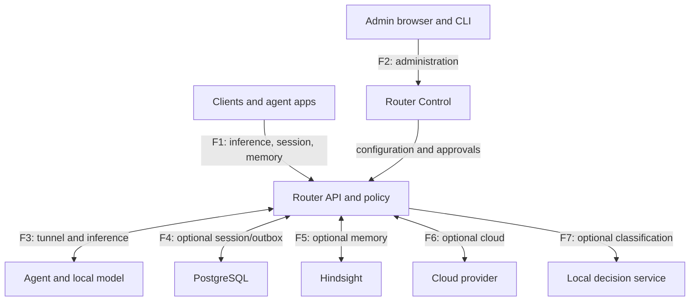

# Skirnir threat model

Version 1.0, 2026-11-03. Baseline: `a41d7f50c324aa5d873dc37757c7b4154b03000c`.
[Detailed German assessment](threat-model.de.md) · [Machine-readable register](risk-register.json)
· [Review process](../../design/continuous-security-review.md).

## Scope and assumptions

Static STRIDE review of selected router/Go agent code, configuration, session/memory design, deployment and CI.
No production inspection, penetration test, complete dependency/history scan or claim that every scenario is exploitable.
Baseline controls are observed in source, not proof of runtime effectiveness. Subsequent reviews record their own
commit/digest and executed tests. The baseline incorporates the November security fixes, rather than treating them
as missing. No personal deployment topology or production data is part of this model.

Consider isolated single-operator, mutually untrusted clients, and externally reachable deployments separately.
Attackers include unauthenticated network peers, hostile web pages, compromised credentialed clients, approved or
pending agents, hostile model/memory content, compromised backends and build/update operators. A compromised host
cannot be contained by API authorization alone.

## Assets and goals

Protect prompts, images, responses, tool results, sessions/checkpoints/compactions, private/shared memory, credentials,
agent/update identities, hosts/GPU/database capacity, provider budgets, audit/provenance and deletion/idempotency ledgers.
Preserve confidentiality, owner/project isolation, integrity, bounded availability and accountable deletion/recovery.
Authentication is not authorization; model output and memory are data, not authority to execute tools.

## Data flows and trust boundaries

API and Control share the router trust domain; these are not isolated processes.

| Boundary | Crossing / security obligation |
| --- | --- |
| B1 | Client → API: token/IP identity, role/model rights, routing and project aliases. |
| B2 | Admin → Control: privileged configuration, registration and updates; browser and proxy trust. |
| B3 | Router ↔ agent/model: key possession plus approval; telemetry and replies remain assertions of that host. |
| B4 | Router ↔ session store (PostgreSQL, or a SQLite file in the state folder since ADR-0114): owner-scoped state, outbox/leases; DBA, file access and backups outside API isolation. |
| B5 | Router ↔ Hindsight: bank/grant enforcement; direct backend access and its own model egress are separate. |
| B6 | Router → cloud: classify the final payload; transmitted bytes cannot be recalled. |
| B7 | Router → classifier: enforce locality; classification has false negatives and is not a hard DLP boundary. |
| B8 | Build/update → host: signing key, trusted origin, platform, version and privilege. |
| B9 | Operations → logs/MQTT/metrics/secrets/backups/CI: separate access, transport and lifecycle policy. |

## Existing controls and residual threats

Priority P1 means address before enabling the affected exposed/multi-principal feature; P2 means harden or explicitly
accept with an owner and expiry. Priorities are conditional, not measured exploit probabilities. All entries remain
open residual scenarios; no acceptance is implied. The register maps proposed V1–V14 checks to existing partial tests.

| ID | STRIDE | Threat, controls and next action |
| --- | --- | --- |
| TM-01 | S/E | Observe mode and IP/NAT trust allow broad inference. Enforce denies unknown clients even with an empty map. Use enforce, locked policy, separate tokens and TLS; since router 0.22.1 `router.py --posture` and the start log report observe mode, an unlocked policy, shared tokens, address-only clients and an API port without TLS (ADR-0064). P1 when exposed. |
| TM-02 | S/E | A local reverse proxy could enter the unauthenticated loopback Control exception. Since router 0.19.0 (ADR-0053) a control port without users answers 503 also on loopback; password-free loopback needs the explicit development switch. Deployment proxies still need Control users and TLS. |
| TM-03 | T/E | Cross-site admin actions: custom header and Fetch Metadata reject simple forms, but not same-origin XSS or stolen admin credentials. Since router 0.22.2 (ADR-0065) inline-handler values are passed as JSON string literals (a node-reported model name could break out before), the control port sends a CSP with connect-src 'self' and frame-ancestors 'none', and no CORS header is set; checked in a browser. Since router 0.42.2 (ADR-0128) the UI runs no inline script: its script is /ui.js, elements name actions in data-* attributes with JSON arguments, and the policy is script-src 'self', so injected markup with an inline handler or script does not run (checked in a browser). Since router 0.42.5 (ADR-0130) the UI uses no inline style either: its styles are /ui.css, the policy is style-src 'self', so injected markup cannot lay an overlay over a control or hide a warning (checked in a browser). Stolen admin credentials are out of scope. P2. |
| TM-04 | E/D/I | Concrete model names bypassed role-only restrictions by default. Since router 0.19.0 (ADR-0052) they need an explicit grant; since router 0.42.16 (ADR-0140) the grant can be a list of concrete models (models: [..]) instead of all (true); a missing setting means roles only and is named in a load-time warning. Since router 0.42.8 (ADR-0131) the listings show a client only the roles it may use and concrete names only with models:true; observe mode without identity sees everything. Since router 0.42.10 (ADR-0133) /api/ps follows the same grants: without models:true a client sees its loaded roles by role name, without concrete model or node. |
| TM-05 | I | Cloud misclassification/false negatives. Client class is a floor, but privacy_check is an intentional exception; cloud:false is the stronger locality control. Since router 0.21.1 a test covers the final payload: memory is inserted before the cloud checks, the credential scan and the privacy rules and classifier read inserted facts as text (before, an escaped non-ASCII term in a recalled fact passed). Since router 0.34.0 (ADR-0099) a provider marked `trust: institutional` in config.yaml (not the web UI) takes its own class limit, below the highest class: the operator vouches for the organisation that runs it; opt-outs, the credential scan, HTTPS and egress still apply, the content check does not run for a provider cleared for the class. Since router 0.42.0 (ADR-0119, ADR-0125) tool results are redacted by configured redactors (`ha_assist` default, `generic_json`) and the rules come from a locale pack (`ch-de` default, `en`); the default is byte-identical to before on a recorded synthetic corpus, a named `generic_json` tool whose result cannot be redacted and JSON too deep to inspect keep the request local, and `unrecognised_tool_results: keep_local` keeps results of unknown formats local. By default such results still pass. Since router 0.42.6 the credential scan reads every text the provider receives (before, content parts on the native chat path and the arguments of tool calls in the history were not read), and the final-payload test includes tool results: the provider gets the redacted copy with memory facts, an unrecognised result passes unchanged by default, keep_local sends nothing. Classifier quality and tool results of unknown formats remain. P1 with cloud. |
| TM-06 | I/S | Provider host allowlisting does not enforce HTTPS in the inspected config; complete redirect behavior remains unverified. Enforce protocol and each destination. P1 with external egress. |
| TM-07 | S/T/I | Pending-slot exhaustion, deceptive agent names or compromised approved agents. Ed25519, approval/revocation, 32-KiB hello, 32 pending and 6 admissions/IP/300s exist. Verify fingerprints separately (README: compare with `skirnir-agent identity` before approval; ADR-0066); active-stream revocation is tested. Since router 0.42.13 (ADR-0136) router.agent_enrollment_networks limits enrollment of new keys to the operator's networks. Since router 0.42.14 (ADR-0137) the router uses an agent's GPU numbers only within the heartbeat schema's ranges and consistent with the total; plausible lies remain possible. P2, P1 for sensitive work. |
| TM-08 | D | Auth/WebSocket floods, long/expensive inference. Since router 0.19.1 (ADR-0057) unauthenticated statistics are capped at 1024 sources and their audit lines are throttled per source and event kind and by a global per-minute budget, with withheld counts. Since router 0.22.0 (ADR-0063) an authenticated client has at most `max_concurrent` requests in progress (default 4) and a declared body of at most `max_body_mib` (default 16). Since router 0.42.3 (ADR-0129) a chunked body is read inside the client's slot within the same limit and refused with 413 once it grows past it. Since router 0.42.11 (ADR-0134) an in-process hostile-load test floods the middleware with an identified client: its requests beyond its slots are refused before their bodies are read, another client is still served, and its refusal audit lines are throttled to one per client and kind per minute (they were unbounded per refusal). Since router 0.42.12 (ADR-0135) a client can have its own monthly cloud budget over all providers (cloud_budget_month); once spent, its cloud tiers are skipped. Measurements on the real deployment remain. P1 when exposed. |
| TM-09 | S/I/E | Stolen tokens or foreign UUID/alias access. Credential principals and owner/project checks exist. Route-inventory tests cover every session, memory and gateway route, also with the gateway enabled; a token rotation through the admin API refuses the old token on memory, gateway and session routes, and a grant revoked by reload refuses recall. A stolen valid token still inherits its rights until rotated. P1 across principals. |
| TM-10 | T/E | Shared-memory poisoning and indirect tool instructions. Grants, provenance and untrusted markers help, but confirmed:true and signatures do not prove truth. Since router 0.20.0 a shared scope names its writers (ADR-0060) and automatic recall does not reach requests that carry tools unless a grant opts in (ADR-0059). A listed writer can still plant false facts, and an opted-in client depends on its own tool confirmation. P1 with automatic tools. |
| TM-11 | I/E | Direct DB/Hindsight access bypasses gateway grants; Hindsight may use its own cloud model. Restrict backends and independently verify their egress. The posture report flags plaintext static nodes and a session store without verified TLS, and the agent example binds a child Ollama to loopback. `agent/Set-OllamaLoopback.cmd` binds node Ollama on Windows to loopback, verifies it and closes the firewall rules that only opened it (ADR-0072); the listening addresses and egress of Hindsight and PostgreSQL still need an inspection on those hosts. P1 for confidential memory. |
| TM-12 | T/I | Retry/restore resurrects data; session deletion does not delete memory. Durable outbox, reauthorization and tombstones exist, TTLs default off. Deletions are journaled outside the database and re-applied at start before the outbox sends; a reconcile deletes them again in a restored Hindsight; `delete_memory_with_session` (opt-in) deletes a session's retained memory with it; stuck deletions are counted (ADR-0076). Backup policies (journal never older than the database) remain operational. P2, P1 for binding erasure needs. |
| TM-13 | T/E | Compromised release/signing, valid old manifests and Ollama origin. Agent verifies signature/platform/hash and, since agent 0.28.0 (ADR-0054), refuses a signed version older than the running release unless the node allows a downgrade explicitly. Since agent 0.29.0 (ADR-0058) several node-local keys can be trusted, so the signing key can be rotated or a leaked key dropped without an update gap; a rotation has been practised once in the deployment (agent 0.29.1). Since ADR-0066 a lost signing key has a recorded replacement (`deploy.py --replace-lost-agent-key`) and `--agent` no longer creates a key silently; the node step is `agent/Set-UpdateKey.cmd`. Ollama uses a separate source/checksum trust model. P2. |
| TM-14 | E/I | Router/agent RCE has a wide host impact. Since router 0.28.0 the router runs as its own account and writes only its state and log folders; `/etc/skirnir-router` is root's and read-only for it (ADR-0086). The agent forwards only inference, listing and version paths to Ollama and refuses Ollama downgrades; the root secret renderers read their access file only from a folder the router cannot see or write, and the router sees its certificates read-only (ADR-0073), since router 0.26.1 also in `/etc/skirnir-router/tls`, the folder of installations older than `router.py --init` (ADR-0082); since router 0.27.0 its start log reports TLS files it could still change or replace, from its own mounts and credentials (`tls_files_changeable`, ADR-0083). Since agent 0.32.0 the Linux agent unit writes no program folder on PATH and keeps only CAP_SYS_ADMIN behind a system call filter without mount calls (ADR-0084), and the agent starts a child only when nobody besides the system and the administrators can change its program, unless `user_writable_reason` accepts it (ADR-0085). Since agent 0.34.0 the Windows agent starts its children as LOCAL SERVICE instead of LocalSystem and grants them only the folders their configuration names, read outside its data folder and modify on their own folder below it; `run_as: system` needs a stated reason (ADR-0088). Since agent 0.34.1 a child's own folder is in a children's data folder next to the agent's, created and protected by the agent, so the agent's folder stays closed to the children even for listing; whether a child can resolve each path is reported (ADR-0091). Since router 0.26.0 (ADR-0080) `render-env.sh` refuses secret values with a line break (each would start a further variable in the root unit's `EnvironmentFile`) and renders further names only when they end in `_KEY` or `_TOKEN`. Since router 0.36.1 (ADR-0104) it can also copy a root-only file (`SECRET_SOURCE=file`, read line by line, never sourced, with the same owner, path, name and value checks) and passes the store's bearer token to curl through stdin instead of the command line. Since router 0.42.15 (ADR-0138) the unit adds the remaining directives a Python network service needs none of (devices, kernel logs, clock, hostname, namespaces, real-time, other processes in /proc, socket families, a system call filter); test/unit_hardening_check.sh runs the router under it in a systemd container. Test privilege separation for updates/hardware. P2. |
| TM-15 | I/R | Logs, query strings, MQTT and backups leak metadata; local audit can be altered. Since router 0.19.1 (ADR-0056) router files are owner-only (0600, unit UMask=0077) and a CI canary test proves that tokens, passwords and prompts stay out of log, audit, journal and overrides on the tested paths; since router 0.21.1 also on memory recall and retention, memory and inference backend errors and the session API, and an unexpected exception is logged without its message (ADR-0062). Since router 0.42.9 (ADR-0132) the audit log rotates by size when client_auth.audit_log_max_mib is set (the example and init configurations set 64 MiB, 5 generations); without it the file grows as before. Backups and independent audit retention remain. P2. |
| TM-16 | T/E | Mutable dependencies/CI tags or release compromise. pip-audit (also on the optional requirement sets) and govulncheck run on every push, pull request and weekly (ADR-0081), and Dependabot exists; since ADR-0055 actions are pinned to commit SHAs, tools to versions and images to digests, enforced in CI. Router hosts install Python packages only from a hash-locked file on top of the distribution's packages, CI from a hash-locked set, both audited and compared with PyPI (ADR-0074). A workflow rebuilds each release's agent binaries from the tag and attests their provenance with SBOMs only if the bytes are identical (ADR-0075); a second job attaches the router's source archive and attests it (ADR-0139); an agent shipped again is rebuilt from the release that first published it when the tag does not reproduce it (ADR-0141). Locks are refreshed by hand (no Dependabot for them). P2. |

## Proposed acceptance checks

V1 auth matrix/wrong-token vs IP; V2 reverse-proxy Control; V3 browser CSRF; V4 role/concrete-model rights;
V5 zero cloud dispatch when prohibited, floors and exceptions; V6 HTTPS/redirect/final payload; V7 enrollment/revocation;
V8 all owner/scope routes; V9 poisoned memory/tool authority; V10 tampered/expired/unauthorized/replayed handoff;
V11 crash/retry/revocation/deletion/restore; V12 bounded load and cost; V13 signature/hash/platform/rollback;
V14 synthetic secret canaries across logs/errors/exports/builds. Existing unit tests are partial evidence, not completion
of these end-to-end objectives. Use only disposable databases and synthetic loopback services. Define load budgets first.

## Response, ownership and maintenance

Revoke compromised client tokens/grants, check queued work and affected shared sources. Isolate/revoke compromised
agents and replace their keys; assume processed prompts could be disclosed. For router compromise rotate backend
credentials, isolate tunnels and rebuild from trusted artifacts; only retain a signing key if its isolation is proven.
Stop workers before restore and reconcile external Hindsight side effects with tombstones before resuming delivery.

Operator owns deployment/egress/access policy; router/agent maintainers own boundary checks and tests; release
maintainers own signing/CI/artifacts. No named personal owners or accepted risks are invented. An acceptance requires
role, scope, rationale, compensating controls and expiry. Review at each PR, weekly, before releases and when endpoints,
grants, providers, routes, updates or retention change. New decisions need ADRs and rejected-case tests.

## Evidence

Baseline source anchors: `router/skirnir_router/{auth,registry,cloud,config,privacy,session_api,memory,session_exchange}.py`,
`agent/{tunnel,updater,ollamaupdate}.go`, `router/skirnir-router.service`, `.github/workflows/security.yml`,
`design/{managed-context,shared-memory-interoperability}.md`. The German assessment contains pinned source links.
`docs/security-review-2026-11-01.md` is the earlier remediation tracker. Its SK-SEC numbering differs from the original
full review after SK-SEC-04; use stable TM IDs here, not assumed number equivalence.
