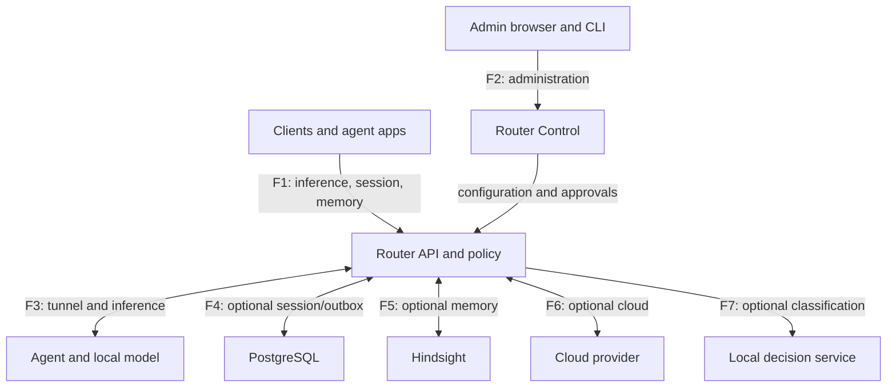

# Skirnir threat model

Version 1.0, 2026-11-03. Baseline: `a41d7f50c324aa5d873dc37757c7b4154b03000c`.
[Detailed German assessment](threat-model.de.md) · [Machine-readable register](risk-register.json)
· [Review process](../../design/continuous-security-review.md).

## Scope and assumptions

Static STRIDE review of selected router/Go agent code, configuration, session/memory design, deployment and CI.
No production inspection, penetration test, complete dependency/history scan or claim that every scenario is exploitable.
Baseline controls are observed in source, not proof of runtime effectiveness. Subsequent reviews record their own
commit/digest and executed tests. The baseline incorporates the November security fixes, rather than treating them
as missing. No personal deployment topology or production data is part of this model.

Consider isolated single-operator, mutually untrusted clients, and externally reachable deployments separately.
Attackers include unauthenticated network peers, hostile web pages, compromised credentialed clients, approved or
pending agents, hostile model/memory content, compromised backends and build/update operators. A compromised host
cannot be contained by API authorization alone.

## Assets and goals

Protect prompts, images, responses, tool results, sessions/checkpoints/compactions, private/shared memory, credentials,
agent/update identities, hosts/GPU/database capacity, provider budgets, audit/provenance and deletion/idempotency ledgers.
Preserve confidentiality, owner/project isolation, integrity, bounded availability and accountable deletion/recovery.
Authentication is not authorization; model output and memory are data, not authority to execute tools.

## Data flows and trust boundaries

API and Control share the router trust domain; these are not isolated processes.

| Boundary | Crossing / security obligation |
| --- | --- |
| B1 | Client → API: token/IP identity, role/model rights, routing and project aliases. |
| B2 | Admin → Control: privileged configuration, registration and updates; browser and proxy trust. |
| B3 | Router ↔ agent/model: key possession plus approval; telemetry and replies remain assertions of that host. |
| B4 | Router ↔ PostgreSQL: owner-scoped state, outbox/leases; DBA/backups outside API isolation. |
| B5 | Router ↔ Hindsight: bank/grant enforcement; direct backend access and its own model egress are separate. |
| B6 | Router → cloud: classify the final payload; transmitted bytes cannot be recalled. |
| B7 | Router → classifier: enforce locality; classification has false negatives and is not a hard DLP boundary. |
| B8 | Build/update → host: signing key, trusted origin, platform, version and privilege. |
| B9 | Operations → logs/MQTT/metrics/secrets/backups/CI: separate access, transport and lifecycle policy. |

## Existing controls and residual threats

Priority P1 means address before enabling the affected exposed/multi-principal feature; P2 means harden or explicitly
accept with an owner and expiry. Priorities are conditional, not measured exploit probabilities. All entries remain
open residual scenarios; no acceptance is implied. The register maps proposed V1–V14 checks to existing partial tests.

| ID | STRIDE | Threat, controls and next action |
| --- | --- | --- |
| TM-01 | S/E | Observe mode and IP/NAT trust allow broad inference. Enforce denies unknown clients even with an empty map. Use enforce, locked policy, separate tokens and TLS. P1 when exposed. |
| TM-02 | S/E | A local reverse proxy could enter the unauthenticated loopback Control exception. Since router 0.19.0 (ADR-0053) a control port without users answers 503 also on loopback; password-free loopback needs the explicit development switch. Deployment proxies still need Control users and TLS. |
| TM-03 | T/E | Cross-site admin actions: custom header and Fetch Metadata reject simple forms, but not same-origin XSS or stolen admin credentials. Verify CORS/UI escaping and real browser behavior. P2. |
| TM-04 | E/D/I | Concrete model names bypassed role-only restrictions by default. Since router 0.19.0 (ADR-0052) they need an explicit models:true; a missing setting means roles only and is named in a load-time warning. Listings still show concrete names. |
| TM-05 | I | Cloud misclassification/false negatives. Client class is a floor, but privacy_check is an intentional exception; cloud:false is the stronger locality control. Test complete final payload and fallback. P1 with cloud. |
| TM-06 | I/S | Provider host allowlisting does not enforce HTTPS in the inspected config; complete redirect behavior remains unverified. Enforce protocol and each destination. P1 with external egress. |
| TM-07 | S/T/I | Pending-slot exhaustion, deceptive agent names or compromised approved agents. Ed25519, approval/revocation, 32-KiB hello, 32 pending and 6 admissions/IP/300s exist. Verify fingerprints separately and test active-stream revocation. P2, P1 for sensitive work. |
| TM-08 | D | Auth/WebSocket floods, long/expensive inference. Since router 0.19.1 (ADR-0057) unauthenticated statistics are capped at 1024 sources and their audit lines are throttled per source and event kind and by a global per-minute budget, with withheld counts. Concurrency/time/byte/cost controls for authenticated traffic remain. P1 when exposed. |
| TM-09 | S/I/E | Stolen tokens or foreign UUID/alias access. Credential principals and owner/project checks exist. Test all CRUD/export/import/gateway/operation paths and rotation. P1 across principals. |
| TM-10 | T/E | Shared-memory poisoning and indirect tool instructions. Grants, provenance and untrusted markers help, but confirmed:true and signatures do not prove truth. Restrict writers and authorize tools separately. P1 with automatic tools. |
| TM-11 | I/E | Direct DB/Hindsight access bypasses gateway grants; Hindsight may use its own cloud model. Restrict backends and independently verify their egress. P1 for confidential memory. |
| TM-12 | T/I | Retry/restore resurrects data; session deletion does not delete memory. Durable outbox, reauthorization and tombstones exist, TTLs default off. Test complete lifecycle and restore. P2, P1 for binding erasure needs. |
| TM-13 | T/E | Compromised release/signing, valid old manifests and Ollama origin. Agent verifies signature/platform/hash and, since agent 0.28.0 (ADR-0054), refuses a signed version older than the running release unless the node allows a downgrade explicitly. Since agent 0.29.0 (ADR-0058) several node-local keys can be trusted, so the signing key can be rotated or a leaked key dropped without an update gap. Ollama uses a separate source/checksum trust model. Define rollback and key recovery. P2. |
| TM-14 | E/I | Router/agent RCE has a wide host impact. Router remains root with systemd restrictions. Test service-account migration and privilege separation for updates/hardware. P2. |
| TM-15 | I/R | Logs, query strings, MQTT and backups leak metadata; local audit can be altered. Since router 0.19.1 (ADR-0056) router files are owner-only (0600, unit UMask=0077) and a CI canary test proves that tokens, passwords and prompts stay out of log, audit, journal and overrides on the tested paths. Rotation, backups and independent audit retention remain. P2. |
| TM-16 | T/E | Mutable dependencies/CI tags or release compromise. pip-audit (also on the optional requirement sets), govulncheck and Dependabot exist; since ADR-0055 actions are pinned to commit SHAs, tools to versions and images to digests, enforced in CI. Hash-locked Python installs and release provenance remain. P2. |

## Proposed acceptance checks

V1 auth matrix/wrong-token vs IP; V2 reverse-proxy Control; V3 browser CSRF; V4 role/concrete-model rights;
V5 zero cloud dispatch when prohibited, floors and exceptions; V6 HTTPS/redirect/final payload; V7 enrollment/revocation;
V8 all owner/scope routes; V9 poisoned memory/tool authority; V10 tampered/expired/unauthorized/replayed handoff;
V11 crash/retry/revocation/deletion/restore; V12 bounded load and cost; V13 signature/hash/platform/rollback;
V14 synthetic secret canaries across logs/errors/exports/builds. Existing unit tests are partial evidence, not completion
of these end-to-end objectives. Use only disposable databases and synthetic loopback services. Define load budgets first.

## Response, ownership and maintenance

Revoke compromised client tokens/grants, check queued work and affected shared sources. Isolate/revoke compromised
agents and replace their keys; assume processed prompts could be disclosed. For router compromise rotate backend
credentials, isolate tunnels and rebuild from trusted artifacts; only retain a signing key if its isolation is proven.
Stop workers before restore and reconcile external Hindsight side effects with tombstones before resuming delivery.

Operator owns deployment/egress/access policy; router/agent maintainers own boundary checks and tests; release
maintainers own signing/CI/artifacts. No named personal owners or accepted risks are invented. An acceptance requires
role, scope, rationale, compensating controls and expiry. Review at each PR, weekly, before releases and when endpoints,
grants, providers, routes, updates or retention change. New decisions need ADRs and rejected-case tests.

## Evidence

Baseline source anchors: `router/skirnir_router/{auth,registry,cloud,config,privacy,session_api,memory,session_exchange}.py`,
`agent/{tunnel,updater,ollamaupdate}.go`, `router/skirnir-router.service`, `.github/workflows/security.yml`,
`design/{managed-context,shared-memory-interoperability}.md`. The German assessment contains pinned source links.
`docs/security-review-2026-11-01.md` is the earlier remediation tracker. Its SK-SEC numbering differs from the original
full review after SK-SEC-04; use stable TM IDs here, not assumed number equivalence.
